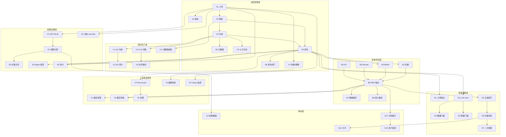

# 知识库专项 PRD（KB-PRD）

> 版本 v1.0.4 | 2026-08-06
> v1.0.4：§13.3.2 知识库模块入口明确（5 大模块 / 三级菜单 / 主入口 / 角色 / 图标 / 展开规则）
> v1.0.3：§13 管理后台深化（13.3–13.15：布局、列表、详情、文档详情、权限、上传、分类、审计、缓存、状态规范、角色差异、移动端）
> v1.0.2：新增 §22 知识库功能模块总览（57 个模块 / 7 大域 / 依赖图 / 现状能力地图）
> v1.0.1：决策确认记录（§21），D01-D18 同步落正文
> v1.0.0：初版
>
> **定位**：本文件是 `PRD.md` 场景 2「知识库管理」+ 第五章「LlamaIndex 集成」的**专项细化与改进方案**，与主 PRD 并列存在；冲突时以主 PRD 为准，本文件作为**实现级补充**（细化数据模型、接口契约、缓存、一致性、可观测等主 PRD 未展开的工程决策）。
>
> **适用范围**：`src/app/modules/knowledge/*`、`src/app/models/knowledge.py`、`src/app/api/v1/knowledge.py`、`src/app/workers/tasks/ingest_document.py`、`src/app/workers/tasks/expire_approvals.py`（新增 `expire_kb_documents`）、`admin-web/src/app/knowledge/**`。
>
> **回溯诊断**：本文件第三章「现状对照」基于 `docs/superpowers/2026-08-03-turn-main-graph.md` 与近两轮代码 review 整理。

---

## 文档版本

| 版本 | 日期 | 主要变更 |
|---|---|---|
| v1.0.0 | 2026-08-06 | 初版：基于主 PRD v0.8.1 + 现状差距分析 + 改进建议的合并设计 |

---

## 一、范围与术语

### 1.1 范围（In Scope）

| 项 | 包含 |
|---|---|
| 文档管理 | 上传、解析、切块、嵌入、QA、命中测试、发布、软删、恢复、版本、过期清理 |
| 检索 | 向量召回 + BM25 召回 + 可选 Rerank（三路）；可选 KG 召回（四路）；统一 RRF 融合 |
| 权限 | KB 级并集鉴权（用户/部门/角色）+ 文档级 `visibility_override` + Agent 绑定 |
| 缓存 | 精确缓存 + 语义缓存；KB 更新触发精准失效 |
| 一致性 | DB ↔ Milvus reconciler；30 天硬删；best-effort 写入带 outbox 重试 |
| 审计 | KB 文档增删/恢复/发布/权限变更/版本切换/LLM 清洗 force_apply 全部入审计 |
| 管理后台 | `admin-web/src/app/knowledge/**` 完整闭环页面 |
| 文档格式 | PDF / Word / Excel / PPT / TXT / Markdown / 网页 URL |

### 1.2 不在本文件范围（Out of Scope）

- **LLM 模型 / Provider / 配额**：遵循主 PRD 第五章。
- **KG 内部实现**：本文件把 KG 视为可选外部依赖，**是否落地四路**由主 PRD 裁定，本文件提供接入接口契约，不实现 Neo4j 客户端。
- **外部 IM 通道**（OpenIM/飞书/钉钉/企微）：延后。
- **多模态**（图片理解、语音）：F1.5 P1，不阻塞本设计。
- **LlamaIndex 引入与否**：依据本次决策 D02，**全面引入 LlamaIndex**（VectorStore / SmartChunker / Retriever / QueryFusion 全套替换自研数据层；详见 §6、§6.6）。

### 1.3 术语

| 术语 | 含义 |
|---|---|
| KB | KnowledgeBase，知识库 |
| Document | KB 下文档，对应 `documents` 表 |
| Chunk | 文档切块，对应 `document_chunks` 表 |
| ParentChunk / ChildChunk | 父子分块中的大块（喂 LLM）/ 小块（检索锚点） |
| Embedding | 向量化（BGE-M3 默认） |
| Rerank | 精排（BGE-Rerank 默认） |
| KB 范围 | KB id 集合，Agent 绑定 ∩ 用户有权 |
| Hybrid 检索 | 向量 + BM25 双路召回 + RRF 融合 |
| D14 | 强制引用溯源裁定，RAG 路径无 citation 拒展 |
| D13 | KB 权限并集合并规则 |
| D7 | 命中测试召回率 ≥80% 闸门 |
| SmartChunker | 按文件类型选分块器的策略 |
| outbox | 异步任务可靠投递模式（Celery 任务入队 + 死信重试） |

---

## 二、用户故事与角色

> 与主 PRD 二章一致；本文件补充**专家角色**与**Agent 绑定**的具体交互。

### 2.1 角色（沿用主 PRD）

| 角色 | 与 KB 的边界 |
|---|---|
| 普通员工 | 检索 KB / 看自己命中历史 |
| 业务专家 | 上传/编辑授权范围内 KB 文档；触发 LLM 清洗、QA 调整、命中测试、发布 |
| Agent 开发者 | 配置 Agent → 绑定多 KB（合并检索）；不直接操作 KB 文档 |
| 部门管理员 | 查看本部门 KB 用量、命中失败率、本部门用户对 KB 的命中行为（脱敏只读） |
| 平台管理员 | 创建/删除/重命名 KB、配 KB 权限、配系统级阈值 |
| 超级管理员 | 同上 + 配置 LLM / 模型 / 缓存策略 |

### 2.2 用户故事

| 编号 | 故事 | 验收 |
|---|---|---|
| US-KB-01 | 作为业务专家，我上传一份 PDF 制度文档，系统自动解析→切块→生成 5 条 QA→跑命中测试，召回率 ≥80% 才能发布 | F2.1+F2.4 |
| US-KB-02 | 作为超管，我把"研发部 KB"可见性设为 department 并自动给该部门全员授权 | F2.8+D13 |
| US-KB-03 | 作为员工，我在系统对话问"年假怎么请"，系统返回答案 + 引用段落 + 可点击跳转文档片段 | F1.2+D14 |
| US-KB-04 | 作为超管，我审计过去 30 天谁改了哪些 KB 权限 | 7.3 安全合规 |
| US-KB-05 | 作为超管，我看到一个已过期的旧文档被系统在 30 天后自动硬删 | F2.6 |
| US-KB-06 | 作为 Agent 开发者，我把多个 KB 绑到一个 Agent，系统按 KB 范围 + 用户权限过滤后合并检索 | F5.2+场景 4 |
| US-KB-07 | 作为业务专家，我把合同类文档走 LLM 清洗并 apply，系统要求二次确认才能落库 | chunk_llm_clean |
| US-KB-08 | 作为平台管理员，我把"无答案阈值"从 0.55 调到 0.60，系统立刻生效，无需重启 | 5.12 + 缓存 |
| US-KB-09 | 作为员工，我的检索命中（KB/文档/相似度）被匿名化统计进 KB 命中率看板 | 7.4 可观测 |
| US-KB-10 | 作为专家，我对某文档建立新版本（旧版本仍可查但不参与检索），随时可回滚 | F2.5 |

---

## 三、现状对照（与改进建议合并）

> 详细诊断见前两轮 review 的"问题清单"输出。本章仅列**与设计直接相关**的现状结论。

### 3.1 已具备（沿用）

| 能力 | 位置 |
|---|---|
| KB/文档/切块/QA/分类数据模型 | `src/app/models/knowledge.py` |
| KB 并集鉴权 | `src/app/modules/knowledge/permissions.py` |
| KB 软删与级联软删文档 | `src/app/modules/knowledge/kb_ops.py` |
| 文档软删与恢复（清切块行与向量） | `src/app/modules/knowledge/document_ops.py` |
| 切块列表/手改/确认/打回 | `src/app/modules/knowledge/chunk_ops.py` |
| 入库编排（OSS 取流 → 解析 → 切块 → metadata → pending_review） | `src/app/modules/knowledge/ingest.py` |
| Hybrid 检索（向量 ∥ BM25 → RRF → 可选 Rerank） | `src/app/modules/knowledge/search.py` |
| 检索编排（KB 范围、权限过滤、filter 计划、citation 装配） | `src/app/modules/knowledge/lookup.py` |
| 意图 filters → 文档范围（含两级 fallback） | `src/app/modules/knowledge/retrieval_plan.py` |
| 命中测试 | `src/app/modules/knowledge/hit_test.py` |
| 发布闸门（qa ≥5 + hit_rate ≥0.8） | `src/app/modules/knowledge/publish.py` |
| LLM 清洗 suggest/apply（含合同保护） | `src/app/modules/knowledge/chunk_llm_clean.py` |
| QA 自动生成（LLM + Mock 兜底） | `src/app/modules/knowledge/generate_qa.py` |
| 文档分类种子 + CRUD | `src/app/modules/knowledge/categories.py`（种子 insert-only；`POST/PATCH/DELETE /doc-categories`） |
| 对话侧 kb_lookup（handlers + Turn Graph 子图） | `src/app/modules/conversation/handlers/kb_lookup.py`、`subgraphs/kb_lookup.py` |
| API 路由（`/api/v1/knowledge-bases`、`/documents`、`/chunks`、`/qa-pairs`、`/hit-test`、`/generate-qa`、`/publish`、`/upload`、`/doc-categories`） | `src/app/api/v1/knowledge.py` |
| Milvus 写入 best-effort + 集合 `za_kb_chunks_v2` | `src/app/modules/knowledge/kb_milvus.py` |
| LangGraph Turn Graph 集成 | `src/app/modules/conversation/turn_graph.py` |

### 3.2 缺口清单（按本文件设计需补齐）

| 缺口 | 等级 | 本文件落点 |
|---|---|---|
| 文档格式不全（缺 Word/Excel/PPT/URL） | P0 | §6 文档解析 |
| 父子分块未实现 | P0 | §6.3 |
| SmartChunker 未实现 | P0 | §6.4 |
| 单集合无 KB 隔离 | P1 | §11.1 |
| QA 兜底用 Mock 模板凑数 | P0 | §9.2 |
| 命中测试用子串匹配 | P0 | §9.3 |
| 文档级 `visibility_override` 未生效 | P0 | §8.2 |
| 30 天到期硬删任务 | P0 | §11.4 |
| KB 文档/权限/版本/LLM 清洗审计 | P0 | §11.5 |
| 文档版本管理 | P0 | §5.5 |
| Milvus ↔ DB 一致性 reconciler | P1 | §11.2 |
| RAG 缓存（精确+语义，KB 更新清缓存） | P1 | §10 |
| 检索全链路 trace | P1 | §13 |
| 上传大小 ≤50MB + MIME 校验 | P0 | §6.2 |
| 无答案阈值 0.55 实际未生效 | P0 | §7.5 |
| 三路并行（< 500ms） | P0 | §7.4 |
| 分类硬编码 8 个种子 | P2 | §4.4 |
| URL 抓取 | P1 | §6.5 |
| LlamaIndex 集成（v0.6.8 决议） | **P0**（D02 升级） | §6、§6.6 |
| 四路 + KG（Neo4j）接入接口 | **P0**（D01 升级） | §7.6 |

---

## 四、数据模型

### 4.1 沿用表（字段微调）

#### `knowledge_bases`（沿用 + 字段新增）

| 字段 | 类型 | 变更 | 说明 |
|---|---|---|---|
| id, name, description | str | 不变 | |
| owner_department_id | str? | 不变 | |
| visibility | str | 不变 | `public` / `department` |
| default_category_ids | str? | 不变（接口补全） | 逗号分隔 `DocCategory.id` |
| embedding_model | str? | **新增** | KB 级 embedding 覆盖（默认 `bge-m3`） |
| rerank_enabled | bool | **新增**，默认 `True` | KB 级 rerank 开关 |
| embedding_collection | str? | **新增** | 独立 collection 名；为空则走共享 `za_kb_chunks_v2` |
| created_by, deleted_at, created_at | 不变 | | |

#### `kb_permissions`（不变）

#### `documents`（沿用 + 新增）

| 字段 | 类型 | 变更 | 说明 |
|---|---|---|---|
| 全部现有字段 | — | 不变 | |
| current_version_id | str? | **新增** | 指向 `document_versions.id`，检索只走 current_version |
| expires_at | datetime? | **新增** | 过期时间；到期进入待清理 |
| hard_delete_at | datetime? | **新增** | 软删 + 30 天后物理删的时间戳 |
| size_bytes | int? | **新增** | OSS 字节数，便于配额 |
| mime_type | str? | **新增** | 上传时识别 |
| parse_strategy | str? | **新增** | `pypdf` / `mineru` / `unstructured_word` / `pandas_xlsx` / `python_pptx` / `trafilatura` |

#### `document_chunks`（沿用 + 父子分块扩展）

| 字段 | 类型 | 变更 | 说明 |
|---|---|---|---|
| 现有字段 | — | 不变 | |
| version_id | str? | **新增**，外键 `document_versions.id` | 每个版本独立切块集 |
| parent_chunk_id | str? | **新增** | 子块指向父块；父块为 `None` 表示顶层块 |
| chunk_role | str | **新增**，默认 `standalone` | `parent` / `child` / `standalone`（旧数据兼容） |
| char_start, char_end | int? | **新增** | 字符偏移，便于前端高亮 |

#### `document_qa_pairs`（沿用 + 质量分）

| 字段 | 类型 | 变更 | 说明 |
|---|---|---|---|
| 现有字段 | — | 不变 | |
| version_id | str? | **新增** | 随版本隔离 |
| source | str | **新增**，默认 `manual` | `manual` / `llm_generated` / `mock_filler` |
| quality_score | float? | **新增** | LLM judge 或规则评分 |

#### `doc_categories`（沿用 + 后台化）

不修改表结构。分类走后台 CRUD（管理端 `/knowledge/categories`）；进程启动/`ensure_seed_categories` **仅补缺、不覆盖**已有行（保护人工改名/启停）。

### 4.2 新增表

#### `document_versions`（文档版本）

| 字段 | 类型 | 说明 |
|---|---|---|
| id | str(32) PK | `ver_<hex>` |
| document_id | str(32) FK | |
| version_no | int | 文档内单调递增 |
| oss_key | str(500) | 该版本对应的 OSS 文件 |
| title | str(255) | 该版本标题 |
| parse_strategy | str | 同 `documents.parse_strategy` |
| size_bytes | int | |
| status | str | `archived` / `active` / `rolled_back` |
| created_by | str(32) | |
| created_at | datetime | |
| rolled_back_from | str(32)? | 若由 `active` 切换而来，记录上一版 |
| is_current | bool | 与 `documents.current_version_id` 双向一致 |

唯一约束：`uk_doc_version_no (document_id, version_no)`。

#### `kb_audit_events`（KB 审计事件）

| 字段 | 类型 | 说明 |
|---|---|---|
| id | bigint PK | |
| occurred_at | datetime | server_default now() |
| actor_user_id | str(32) | 操作人 |
| actor_role | str | 操作人角色（快照） |
| action | str | 枚举：`kb.create` / `kb.delete` / `kb.permission.put` / `doc.upload` / `doc.parse_failed` / `doc.chunk_update` / `doc.confirm` / `doc.reopen` / `doc.publish` / `doc.unpublish` / `doc.soft_delete` / `doc.recover` / `doc.version_create` / `doc.version_rollback` / `doc.qa_replace` / `doc.qa_generate` / `doc.hit_test` / `doc.llm_clean_apply` / `kb.cache_invalidate` |
| kb_id | str(32)? | |
| document_id | str(32)? | |
| version_id | str(32)? | |
| payload_json | text | 结构化事件详情（脱敏） |
| request_id | str? | 链路 ID |
| success | bool | |
| error_code | str? | 失败时 |

#### `rag_cache_entries`（RAG 精确缓存）

| 字段 | 类型 | 说明 |
|---|---|---|
| id | bigint PK | |
| cache_key | str(64) | sha256(agent_id + role_hash + user_dept_hash + query_norm) |
| kb_ids_json | text | 命中时涉及的 KB 列表 |
| query_norm | str(500) | 归一化查询串 |
| citations_json | text | citation 列表 |
| answer_text | text | 合成答案 |
| hit_count | int default 0 | |
| expires_at | datetime | TTL 24h 或被 invalidate 提前失效 |
| created_at, updated_at | datetime | |

唯一索引：`uk_cache_key (cache_key)`。

> 语义缓存放在向量库内（Milvus 单独 collection），不占用关系表，详见 §10。

#### `kb_doc_invalidation_log`（缓存失效日志）

| 字段 | 类型 | 说明 |
|---|---|---|
| id | bigint PK | |
| triggered_at | datetime | |
| reason | str | `doc_confirm` / `doc_recover` / `qa_replace` / `doc_publish` / `doc_soft_delete` / `version_rollback` / `permission_put` |
| affected_kb_ids_json | text | 受影响的 KB 列表 |
| affected_document_ids_json | text | |
| purged_cache_keys | int | 实际清掉的精确缓存条数 |
| purged_semantic_vectors | int | 语义缓存清掉的向量数 |

### 4.3 关系图（核心实体）

```
KnowledgeBase 1───n Document 1───n DocumentVersion 1───n DocumentChunk
                       │                                  │
                       └──n DocumentQaPair ──────────────┘
                       └──1(current_version_id)→ DocumentVersion

KnowledgeBase 1───n KbPermission
KnowledgeBase 1───n KbAuditEvent
Document       1───n KbAuditEvent
```

---

## 五、文档生命周期

### 5.1 状态机（升级版）

```
draft → processing → pending_review → ready → published
                      │                │        │
                      ↓                ↓        ↓
                   failed          pending_review  published(终态)
                      │              (reopen)
                      ↓
                pending_review (retry)

* 任何状态 (除 draft/processing) 可走 soft_deleted → hard_deleted（30 天后）
```

| 状态 | 进入条件 | 离开条件 |
|---|---|---|
| `draft` | 创建文档元数据（未上传） | 上传文件 → `processing` |
| `processing` | 入库任务启动 | 解析成功 → `pending_review`；解析失败 → `failed` |
| `pending_review` | 切块 + metadata 就绪 | 专家 confirm → `ready` |
| `ready` | 向量已写入 Milvus | 专家 publish → `published`；reopen → `pending_review` |
| `published` | 命中测试通过且发布 | （终态；只能软删） |
| `failed` | 解析失败 / metadata 抽取失败 | 重新上传覆盖 → `processing` |
| `soft_deleted` | 任何非 draft/processing 状态可触发 | 30 天后 → `hard_deleted`；专家恢复 → `ready` |
| `hard_deleted` | 30 天到期清理任务 | 终态（行物理删除） |

### 5.2 入库流水线（含 SmartChunker）

```
Web 上传（≤50MB + MIME 校验）
   ↓
OSS 写流（f"kb/{kb_id}/{doc_id}/{filename}"）
   ↓
Celery 任务 ingest_document_task.delay(doc_id)
   ↓
按 mime/extension 选 parser：
   - .pdf       → MinerU（本地）→ fallback pypdf
   - .docx      → UnstructuredWord / python-docx
   - .xlsx/.xls → pandas (per-row chunker)
   - .pptx      → python-pptx (per-slide chunker)
   - .md        → MarkdownNodeParser（**LlamaIndex 主路径**）
   - .txt       → SimpleDirectoryReader
   - URL        → Trafilatura 抓 HTML
   ↓
SmartChunker 按文件类型分块（详见 §6.4）
   ↓
metadata_extract（按 DocCategory.schema_code）
   ↓
document_versions 行 + document_chunks 行（version_id 隔离）
   ↓
status = pending_review
   ↓
专家在前端：手改 / LLM 清洗 / 跑命中测试 / 发布
```

### 5.3 版本管理

| 动作 | 行为 |
|---|---|
| 上传新版本 | 创建新 `document_versions` 行（`version_no` 自增），`documents.current_version_id` 切到新版；旧版标记 `archived` |
| 检索 | 只走 `current_version_id` 关联的 `document_chunks` |
| 回滚 | 把 `current_version_id` 切回旧版本；旧版本 `status` 改回 `active`，被替换的版本变 `archived` |
| 版本对比 | 前端按 `version_no` 列表展示新旧切块差异（diff 不强制，列表即可） |
| 容量控制 | 每文档最多保留 **5 个**历史版本，超出自动清理最旧 `archived` |

### 5.4 软删与到期硬删

| 阶段 | 行为 |
|---|---|
| 软删 | `documents.deleted_at = now()`；`document_chunks` 物理删（按当前 version_id）；Milvus 向量 `delete_kb_vectors_by_document`；`hard_delete_at = now() + 30d` |
| 30 天扫描 | Celery beat 周期任务 `expire_kb_documents`（每天 03:00）扫 `hard_delete_at <= now()` 且未硬删的行 |
| 硬删 | 删 OSS 文件、删 Milvus 向量兜底、删 `document_chunks`（按所有 version_id）、删 `documents` 行、删 `document_qa_pairs`、写 `kb_audit_events`（`kb.doc.hard_delete`） |
| 恢复 | 软删状态下可恢复（`recover_document`），`status` 置回 `ready`，**不重新入库**；如想重新检索，需 `confirm_chunks` 重跑向量化 |

### 5.5 LLM 清洗契约

沿用 `chunk_llm_clean` 既有逻辑，新增：

| 项 | 决策 |
|---|---|
| 合同保护 | 合同类文档 apply 必须 `force_apply=True` 才落库；UI 二次确认 |
| 审计 | apply 成功/失败都写 `kb_audit_events.action = doc.llm_clean_apply`，含变更 chunk 数与字符数 |
| 版本隔离 | 清洗只影响 `current_version_id` 对应的 chunks |
| 失败回滚 | LLM 调用失败 → 全部回退，文档保持原 `pending_review` 状态 |

---

## 六、文档解析与切块

### 6.1 解析器矩阵

| 文件类型 | 主解析器 | 失败降级 | 写 `parse_strategy` |
|---|---|---|---|
| `.pdf` | **MinerU（本地容器）** | pypdf | `mineru` / `pypdf` |
| `.docx` | UnstructuredWord / python-docx | — | `unstructured_word` |
| `.xlsx` / `.xls` | pandas + openpyxl（行级 + 表头） | — | `pandas_xlsx` |
| `.pptx` | python-pptx（每 slide 一块） | — | `python_pptx` |
| `.md` | MarkdownNodeParser（**LlamaIndex 主路径**） | 段落切分 | `markdown` |
| `.txt` | SimpleDirectoryReader | — | `txt` |
| `.html` / URL | Trafilatura | html.parser | `trafilatura` |

### 6.2 上传校验

| 项 | 规则 |
|---|---|
| 大小 | 单文件 ≤ 50MB（超出 413） |
| MIME | 取 OSS 头 + python-magic 双校验；不匹配返回 415 |
| 文件名 | 重命名为 `{uuid}.{ext}`，原名存 `documents.title`；拒绝 `../`、绝对路径、NUL |
| 病毒扫描 | v1.0 不接 ClamAV；后台管理提示 P1 |

### 6.3 父子分块（SmartChunker 默认）

| 文件类型 | 父块大小 | 子块大小 | 父块规则 | 子块规则 |
|---|---|---|---|---|
| PDF（制度文档） | 1000 字 | 200 字 | 段落为父 | 句号/换行为子 |
| Markdown | 标题到下一同级标题 | 段落 | 标题层级 | 段落 |
| Word | 段落聚合 | 单段 | Heading 分组 | 段落 |
| Excel | 表 + 50 行 | 单行 | 列头 + 行组 | 单行 |
| PPT | 单 slide | 单 slide 内要点 | slide 标题 | 项目符号 |
| 网页 | 文章 section | 段落 | H2/H3 切分 | 段落 |

- 父子块均写入 `document_chunks`，通过 `parent_chunk_id` 与 `chunk_role` 区分；
- 检索只对**子块**建索引；父块用于 LLM 喂上下文（命中若干子块 → 取对应父块）；
- 父块检索权重 = 子块命中数 / 该父块总子块数。

### 6.4 SmartChunker（LlamaIndex 主路径 + 自研可替换）

> 依据决策 D02：**LlamaIndex 全面引入**，SmartChunker 默认走 LlamaIndex `SmartChunker` 框架；保留自研实现作为应急回滚路径。

```python
class SmartChunker:
    def __init__(self, parse_strategy: str):
        self.strategy = parse_strategy

    def chunk(self, text: str, *, parent_size: int = 1000, child_size: int = 200) -> list[ParentChildChunk]:
        if self.strategy in ("mineru", "pypdf"):
            return self._pdf_chunk(text, parent_size, child_size)
        if self.strategy == "markdown":
            return self._md_chunk(text)
        if self.strategy == "pandas_xlsx":
            return self._xlsx_chunk(text)
        # ... 其它文件类型
        return self._generic_chunk(text, parent_size, child_size)
```

- 入口在 `src/app/modules/knowledge/chunking.py`，**保留现有函数签名兼容旧调用方**，新增 `SmartChunker` 类；
- 配置项 `kb_chunk_parent_size=1000`、`kb_chunk_child_size=200`、`kb_chunk_child_overlap=40` 写入 `app/core/config.py`；
- 父子块写入不同 `chunk_role`，但**均带 `version_id` 隔离**。

### 6.5 URL 抓取

| 项 | 决策 |
|---|---|
| 抓取器 | Trafilatura（本地） |
| 超时 | 5 秒 |
| 黑名单 | 内网地址需在管理后台配置白名单 |
| 抓取后 | 同普通文档入库（HTML→markdown→SmartChunker） |
| 重抓 | 支持 `/documents/{id}/refresh-url` Celery 任务 |

### 6.6 LlamaIndex 集成（主路径，依据 D02）

- **Milvus VectorStore**：`LlamaIndex.vector_stores.MilvusVectorStore` 包装，替代直连 `pymilvus.Collection`；
- **SmartChunker**：`llama_index.core.node_parser` 全套（`MarkdownNodeParser` / `SemanticSplitterNodeParser` / `HierarchicalNodeParser` / `CodeSplitter` / 文件类型感知）；
- **Retriever**：VectorRetriever + BM25Retriever 自定义 + QueryFusionRetriever 组合；
- **配置项**：`kb_chunker_backend = "llamaindex" | "native"`，默认 `llamaindex`；
- **回滚开关**：紧急情况可切 `native` 回退到自研 chunking（§6.4 自研实现保留）；
- **新增文件**：
  - `src/app/modules/knowledge/llama_index/`：集成包
  - `src/app/modules/knowledge/llama_index/vector_store.py`：Milvus VectorStore 包装
  - `src/app/modules/knowledge/llama_index/smart_chunker.py`：文件类型 → chunker 路由
  - `src/app/modules/knowledge/llama_index/retriever.py`：四路并行检索器（含 KG Retriever 接入点）

---

## 七、检索流水线

### 7.1 调用链

```
TurnGraph.kb_lookup_node
  ↓
execute_system_kb_lookup (handlers/kb_lookup.py)
  ↓
run_kb_lookup (knowledge/lookup.py)
  ├─ resolve_kb_ids_for_agent (Agent 绑定 ∩ 用户有权)
  ├─ list_accessible_kb_ids (并集鉴权)
  ├─ filter_documents_by_plan (意图 filters → 文档范围，含两级 soft fallback)
  ├─ 缓存查询（精确 → 语义 → 命中即返回）
  └─ search_kb_chunks (Hybrid 检索 + 可选 Rerank)
      ├─ _dense_rank (Milvus 向量 → 本地余弦 fallback)
      ├─ bm25_scores (本地 BM25)
      ├─ rrf_fuse (RRF 融合)
      └─ _maybe_rerank (BGE-Rerank，本地 CPU)
  ↓
hits_to_citations (title/snippet 装配)
  ↓
D14 闸控 (rag_stub_has_citation + evaluate_rag_citation_gate)
  ↓
synthesize_kb_answer (LLM 短答 / Mock 模板)
  ↓
缓存回写（精确 + 语义）
```

### 7.2 KB 范围与权限过滤（顺序敏感）

1. **Agent 绑定 KB**：Agent 可选多 KB；未绑定 → 全部未软删 KB。
2. **用户有权 KB**：并集算权（用户/部门/角色）；管理员跳过。
3. **取交集**：检索只在 `agent ∩ user_permitted` 中进行。
4. **文档级 override**：`documents.visibility_override` 决定单文档是否进一步收窄可见性（详见 §8.2）。

### 7.3 意图 → 文档范围

沿用 `retrieval_plan.build_retrieval_filters`；新增：

| 决策 | 落点 |
|---|---|
| filters 与 KB 范围**并行计算**，不强依赖 | `filter_documents_by_plan` 不返回 None 视作缩范围 |
| soft fallback 触发率上报到 Prometheus | `kb_filter_fallback_total{stage="meta"\|"category"}` |
| 空结果回落 | 文档范围为空 → 退化为 KB 内全文检索（document_ids=None） |

### 7.4 并行执行（目标 < 500ms）

| 阶段 | 操作 | 耗时预算 |
|---|---|---|
| T0 | 权限/范围/filters | < 30ms（Redis 缓存） |
| T1 | 缓存查询（精确 + 语义） | < 20ms |
| T2 | Hybrid 检索（三路**并行**） | < 200ms |
| T3 | Rerank（如启用） | < 150ms |
| T4 | Citation 装配 + D14 闸控 | < 30ms |
| T5 | 答案合成（流式首字延迟） | < 1500ms |

实现要点：
- `asyncio.gather` 并行三路（向量 / BM25 / KG）；
- 切块行**只在 Rerank 阶段按需加载**正文，预选阶段只取 `id + embedding_id`；
- Milvus `load_collection` 启动预热（应用启动钩子）。

### 7.5 无答案兜底（D14 + 阈值）

| 项 | 决策 |
|---|---|
| 无答案阈值 | 系统级配置 `kb_no_answer_threshold=0.55`；KB 级可覆盖（`knowledge_bases.no_answer_threshold`） |
| 触发 | top-5 hits 的最高 score < 阈值 |
| 回复模板 | "抱歉，未找到与您问题相关的信息。您可以：1) 换个关键词；2) 描述更具体；3) 联系 XX 部门。"（沿用主 PRD 13.3） |
| D14 强制 | 即便阈值通过，citation 列表为空 → `rejected_no_citation` 拒展 |
| 上报 | `kb_no_answer_total{agent_id,kb_id}` Prometheus 指标 |

### 7.6 RAG 答案可信度闸控（五道闸门）

> 主 PRD D14「强制引用溯源」原则下的工程细化：从"无 citation 拒展"扩展为**五道串联闸门**，任一失败即拒展并给出针对性文案。

#### 7.6.1 闸门清单

| 编号 | 闸门 | 触发条件（拒展） | 错误码 | Prometheus 指标 |
|---|---|---|---|---|
| G1 | **召回分低于阈值** | top-k hits 最高 score < `kb_no_answer_threshold`（默认 0.55；KB 级可覆盖） | `rejected_no_recall` | `kb_no_recall_total{agent_id,kb_id}` |
| G2 | **证据缺少主题条件** | 所有 citation 的 snippet + title 都未覆盖 query 任一主题词/命名实体 | `rejected_topic_missing` | `kb_topic_missing_total{agent_id,kb_id}` |
| G3 | **证据互相冲突** | citations 之间存在硬冲突（同一实体结论相反：肯定 vs 否定 / 允许 vs 禁止） | `rejected_conflict` | `kb_conflict_total{agent_id,kb_id}` |
| G4 | **关键字缺失** | 合成答案中的关键实体/术语未被任何 citation 覆盖（覆盖率 < `kb_keyword_coverage_min=0.8`） | `rejected_keyword_missing` | `kb_keyword_missing_total{agent_id}` |
| G5 | **答案无法绑定** | 合成答案任一事实句子与全部 citations 的蕴含分 < `kb_answer_bind_threshold=0.7`（含编造） | `rejected_unbound` | `kb_unbound_total{agent_id}` |

#### 7.6.2 闸门链顺序与短路

```
G1（召回分）→ G2（主题覆盖）→ G3（冲突检测）→ G4（关键字覆盖）→ G5（句子绑定）
                ↓ 命中即拒展并跳过后续闸门
```

- 任一闸门拒展即**短路**，后续闸门不再执行（节省 LLM 调用）；
- G5 是最后一道闸门，**对应主 PRD D14**，是底线。

#### 7.6.3 各闸门实现要点

**G1 召回分阈值**
- 输入：`hits: list[dict]`，每条含 `score`（来自 RRF 融合）
- 计算：`max_score = max(h.score for h in hits if h.score is not None)`
- 阈值：系统级 `kb_no_answer_threshold=0.55`；KB 级 `knowledge_bases.no_answer_threshold` 覆盖；运行时配置覆盖
- 拒展文案：沿用 §7.5 标准兜底

**G2 证据缺少主题条件**
- 主题词抽取：
  - 中文 NER（轻量规则 + 词典，< 30ms）：人名/地名/职位/产品/制度名/编号
  - 关键词抽取：jieba + TF-IDF（< 20ms）
- 计算：对每条 citation 的 `title + snippet`，主题词集合交集覆盖率
- 阈值：`kb_topic_coverage_min=0.5`（至少覆盖一半主题词）
- 拒展文案："检索到的资料似乎与您的问题主题不符，建议您换个更具体的描述，或联系 XX 部门。"

**G3 证据互相冲突**
- 冲突识别双路：
  - 规则层：相同实体在 citations 中出现"是/不是、允许/禁止、应/不应"等相反极性词
  - LLM judge 层：对 citations 两两判矛盾（**预计算缓存**：同 kb_id + 同 query hash 缓存 24h）
- 冲突分级：
  - **硬冲突**（直接相反）→ 拒展
  - **软冲突**（补充/限定/版本差异）→ 不拒展，回复中追加"以下资料存在不同说法"
- 拒展文案："检索到的资料存在不同说法，建议联系 XX 部门核实。"
- 开关：`kb_conflict_check_enabled=True`（默认开启）

**G4 关键字缺失**
- 关键字集合：
  - query 抽取的实体
  - 答案中关键名词/术语（通过答案 NER 回抽）
- 校验：每个关键字必须在 citations 中至少出现 1 次（substring 或 embedding 余弦 ≥ 0.85）
- 阈值：`kb_keyword_coverage_min=0.8`
- 拒展文案："当前资料未覆盖您问题的关键要点，请补充上下文或联系 XX 部门。"
- 失败动作：默认**不重试**（避免循环）；可配 `kb_keyword_retry=true` 时触发一次"无 citation 提示"路径

**G5 答案无法绑定**
- 句子级绑定：把合成答案按 `。/！/？/\n` 切句
- 每句话与 citations 做 NLI 蕴含：
  - 首选 BGE-Reranker v2（含 NLI head，本地 CPU，< 150ms / 句）
  - 备选 LLM judge（异步，命中率低时走）
- 阈值：`kb_answer_bind_threshold=0.7`
- 缓存：`(answer_hash, citations_hash)` → bind_result 缓存 24h
- 拒展文案："生成的内容缺少明确依据，建议换个问法或联系 XX 部门。"
- **对应主 PRD D14**，是当前 `runtime.evaluate_rag_citation_gate` 的升级版

#### 7.6.4 拒展回复模板分流

| 错误码 | 文案模板 |
|---|---|
| `rejected_no_recall` | §7.5 标准兜底（沿用主 PRD 13.3） |
| `rejected_topic_missing` | 主题偏离引导（见 G2） |
| `rejected_conflict` | 冲突提示 + 建议核实（见 G3） |
| `rejected_keyword_missing` | 关键点缺失引导（见 G4） |
| `rejected_unbound` | D14 拒展（见 G5） |

每条文案都包含**动作引导**：换关键词 / 描述更具体 / 联系部门三类建议按需组合。

#### 7.6.5 实现位置

| 模块 | 文件 |
|---|---|
| 闸门链主控 | `src/app/modules/knowledge/quality_gate.py`（**新增**） |
| 主题词 / 关键词抽取 | `src/app/modules/knowledge/extract_terms.py`（**新增**） |
| 冲突识别 | `src/app/modules/knowledge/conflict_detect.py`（**新增**） |
| 句子级 NLI 绑定 | `src/app/modules/knowledge/binding.py`（**新增**） |
| G3 / G5 缓存 | 复用 §10 `rag_cache_entries`（新增 `quality_gate_cache` 子表） |
| 对接 `execute_system_kb_lookup` | `src/app/modules/conversation/handlers/kb_lookup.py` |
| Prometheus 指标 | `src/app/modules/observability/metrics.py`（**新增**） |
| 审计 | 复用 §11 `kb_audit_events`（`action = kb.quality_gate.reject`） |

#### 7.6.6 性能预算

| 闸门 | 命中缓存 | 未命中缓存 |
|---|---|---|
| G1 | < 5ms | < 5ms |
| G2 | < 50ms | < 50ms |
| G3 | < 10ms | < 100ms（LLM judge） |
| G4 | < 30ms | < 30ms |
| G5 | < 20ms | < 200ms（NLI） |
| **合计** | **< 60ms** | **< 400ms** |

整体检索链路（含五道闸门）目标 P95 < 500ms（沿用主 PRD 7.1）。

#### 7.6.7 配置项

```python
# app/core/config.py 新增
kb_quality_gate_enabled: bool = True
kb_no_answer_threshold: float = 0.55           # G1
kb_topic_coverage_min: float = 0.5            # G2
kb_keyword_coverage_min: float = 0.8          # G4
kb_answer_bind_threshold: float = 0.7         # G5
kb_conflict_check_enabled: bool = True        # G3
kb_nli_model: str = "bge-reranker-v2-m3"      # G5
kb_keyword_retry: bool = False                # G4 失败时是否重试
```

#### 7.6.8 观测与审计

- 每道闸门失败都上报 Prometheus counter（label：`gate` / `agent_id` / `kb_id`）；
- 拒展事件写 `kb_audit_events`（`action = kb.quality_gate.reject`，payload 含失败闸门、相关 citation id、reason 详情）；
- 看板：每道闸门拒展占比 / 联合拒展占比 / 单 KB 拒展率 Top N；
- 用户反馈（👍/👎）关联闸门结果，用于离线评估与阈值调优；
- A/B 框架（v1.1）：可临时放开门槛跑对照组。

#### 7.6.9 与 D14 的关系

- 原 `runtime.evaluate_rag_citation_gate`（"citation 列表为空 → 拒展"）对应**简化版 G5**；
- 本节把 D14 闸控从单一条件扩展为**五道串联闸门**；
- 主 PRD D14 仍为闸控的最高原则；本节为工程实现细化与可观测化；
- 后续主 PRD 修订时，可把"五道闸门"反向同步进 D14 表述。

### 7.7 KG 接入接口（可选四路）

> 主 PRD 已裁定 KG 为 P0 路径，但本文件不实现 Neo4j 客户端，仅留接口。

```python
# src/app/modules/knowledge/retrievers/kg_retriever.py
class KGRetriever(Protocol):
    async def retrieve(
        self,
        *,
        query: str,
        kb_ids: list[str],
        top_k: int,
        timeout: float = 2.0,
    ) -> list[dict]: ...
```

- 默认实现 `NoOpKGRetriever`（返回空，超时 0）；
- **Neo4jAdapter v1.0 实现**：单库 Neo4j 社区版，作为四路检索的第四路；
- `run_kb_lookup` 在三路之上 `asyncio.gather` 一个 KG 调用，**超时 2s 跳过**（沿用主 PRD 7.1）；
- KG 输出走相同 RRF 融合（与向量/BM25 同列表融合）；
- KG 命中同样参与 §7.6 五道闸门（G2/G3/G4/G5 都作用于"所有 citations"，含 KG）。

### 7.8 异常处理动作分流（四类动作）

> §7.6 五道闸门判定"是否拒展"，本节定义判定结果对应的**用户交互动作**：拒答 / 澄清卡 / 缺口说明 / 生成答案。把"判定结果"映射到"前端形态 + 卡片类型 + 用户回传后的二次检索"。

#### 7.8.1 闸门结果 → 动作决策表

| 闸门链终止点 | 闸门错误码 | 动作 | 用户形态 |
|---|---|---|---|
| G1 失败 | `rejected_no_recall` | **A1 拒绝回答** | 纯文本 Markdown，可选附挂 `route_clarify` |
| G2 失败 | `rejected_topic_missing` | **A2 澄清卡** | `ask_choice`（候选主题词） |
| G3 失败 | `rejected_conflict` | **A3 提示冲突 + 澄清卡** | 冲突摘要文本 + `ask_choice`（选版本/核实） |
| G4 失败 | `rejected_keyword_missing` | **A4 说明缺口** | 纯文本 Markdown + 可选 `ask_form`（动态字段） |
| G5 失败 | `rejected_unbound` | **A5 D14 拒展** | 纯文本 Markdown（不附卡片） |
| G1–G5 全通过 | — | **A6 生成答案** | 流式 Markdown + citations + 👍/👎/重试 |

#### 7.8.2 四类动作详细设计

**A1 拒绝回答（G1 失败）**
- 形态：纯文本 Markdown，§7.5 标准兜底文案（沿用主 PRD 13.3）
- 可选附挂 `route_clarify` 卡片：让用户选"换个 Agent / 问其他部门"
- 配置：`kb_no_recall_action ∈ {reject, clarify, both}`，默认 `both`
- 不阻塞对话；用户可继续提问

**A2 澄清卡（G2 失败 / 软缺失）**
- 卡片类型：`ask_choice`（沿用主 PRD 3.3.2b）
- 选项生成：
  - 从 query 抽取候选主题词/命名实体作为选项，最多 5 个
  - 兜底含"以上都不是，请补充"
- 选项回传：作为新一轮检索的 `route.slots.filters`，触发窄化召回
- 后端**不直接给答案**，用户选完重新跑 §7.6 五道闸门
- 卡片示例：
  ```
  您的问题似乎没找到精确匹配。请选择更具体的主题：
  ☐ 年假规定
  ☐ 病假规定
  ☐ 调休规定
  ☐ 其它（请补充描述）
  ```

**A3 提示冲突 + 澄清卡（G3 失败）**
- 形态：冲突摘要文本 + `ask_choice`
- 冲突摘要格式：
  ```
  检索到两份资料结论相反：
  - 《文档 A · 年假制度 v3》：「年假 5 天起」
  - 《文档 B · 年假制度 v5》：「年假 10 天起」

  请您选择：
  ☐ 按 A 处理（v3）
  ☐ 按 B 处理（v5）
  ☐ 联系 XX 部门核实
  ☐ 重新提问
  ```
- 用户选项处理：
  - 选 A/B → 把对应 `document_id` 注入 filters 重检索（A 文档优先）
  - 选核实 → 触发站内通知到 XX 部门（v1.1）；当前仅文本提示
  - 选重提 → 清空本轮 KB 缓存，回原始 query
- 审计：选 A/B 写 `kb_audit_events`（action=`kb.conflict.resolve`）

**A4 说明缺口（G4 失败）**
- 形态：纯文本 Markdown + 可选 `ask_form`
- 文案格式：
  ```
  当前检索到的资料未完全覆盖您问题的关键要点：
  - 缺少「年假天数」相关条款
  - 缺少「适用岗位」相关条款

  您可以补充：
  [ 您的岗位类型：_______ ]
  [ 入职时间：_______ ]

  或换个问法重试。
  ```
- `ask_form` 字段：按缺口动态生成，最多 3 个短字段（受 `kb_gap_form_max_fields` 约束）
- 用户提交：表单内容追加到 query 重检索（不直接给答案）

**A5 D14 拒展（G5 失败）**
- 形态：纯文本 Markdown
- 文案：§7.6.3 G5（"生成的内容缺少明确依据"）
- **不附卡片**（避免诱导用户陷入循环）
- 这是 §7.6 闸控的最高红线，对应主 PRD D14

**A6 生成答案（闸门全通过）**
- 形态：流式 Markdown（SSE，沿用现有 §7.1 链路）
- 附 citations（来自 RRF 融合后的 hits）
- 卡片：可选 `actions`（👍/👎/重试/打开原文），沿用主 PRD 3.3.2b
- 不附强制卡片（保持流式体验）

#### 7.8.3 动作分流接口契约

```python
# src/app/modules/knowledge/quality_actions.py（新增）
class QualityAction(str, Enum):
    REJECT = "reject"            # A1
    CLARIFY = "clarify"          # A2 / A3
    EXPLAIN_GAP = "explain_gap"  # A4
    D14_REJECT = "d14_reject"    # A5
    ANSWER = "answer"            # A6


@dataclass
class QualityGateResult:
    action: QualityAction
    error_code: str | None
    text_response: str | None        # REJECT / EXPLAIN_GAP / D14_REJECT
    card_payload: dict | None        # CLARIFY (ask_choice/ask_form)
    citations: list[dict]            # ANSWER 必带；CLARIFY 可附
    conflict_summary: dict | None    # 仅 A3（{"docs": [...], "diffs": "..."}）
    gap_fields: list[dict] | None    # 仅 A4（ask_form 字段定义）
    gate_failed: str | None          # 失败闸门编号 G1-G5


async def run_quality_gate(
    *, query: str, hits: list[dict], citations: list[dict],
    answer: str | None, kb_id: str,
) -> QualityGateResult: ...
```

#### 7.8.4 用户回传后的二次检索流程

```
A2/A3/A4 用户提交选项或表单
   ↓
把回传内容注入 route.slots.filters 或 query
   ↓
重新执行 run_kb_lookup → run_quality_gate
   ↓
通过 → A6；不通过 → 按本节再分流（≤ kb_clarify_max_retries 轮）
   ↓
超过最大轮数（默认 2）→ 强制 A1 兜底
```

- 计数维度：按 `conversation_id + user_message_id` 累加，跨 turn 独立计数；
- 防循环：超过最大轮数后，**锁死本轮 KB 路径**，下一次用户提问重新计数。

#### 7.8.5 与 §7.6 / D14 / 主 PRD 13.3 的关系

| 来源 | 关系 |
|---|---|
| §7.6 五道闸门 | 上游：判定 `QualityGateResult.action` |
| 主 PRD D14 | 最高原则 → 本节 A5 |
| 主 PRD 13.3 标准兜底 | 本节 A1 文案来源 |
| 主 PRD 3.3.2b 交互卡片 | 本节 A2/A3/A4 卡片类型来源（`ask_choice` / `ask_form`） |
| §7.5 无答案阈值 | 本节 A1 触发条件 |

#### 7.8.6 配置项

```python
# app/core/config.py 新增
kb_no_recall_action: Literal["reject", "clarify", "both"] = "both"
kb_clarify_max_retries: int = 2
kb_gap_form_max_fields: int = 3
kb_conflict_send_notification: bool = False   # v1.0 默认关
kb_topic_choice_max_options: int = 5
```

#### 7.8.7 观测

- 每个 action 上报 Prometheus counter：
  - `kb_quality_action_total{action, agent_id, kb_id}`
  - action ∈ `{reject, clarify, explain_gap, d14_reject, answer}`
- 二次检索成功率：`kb_clarify_retry_pass_total` / `kb_clarify_retry_total`
- 闸门 → 动作分布看板：用于调优澄清话术与缺口文案
- 用户反馈（👍/👎）关联到具体 action，用于离线评估动作选择合理性

#### 7.8.8 不做的边界

- ❌ 不实现"按 Agent 重路由"（A1 附挂的 `route_clarify` 仅文本提示，不触发路由层）；
- ❌ 不实现"核实"动作触发 IM/邮件通知（v1.1，依赖通知通道接入）；
- ❌ 不实现 LLM 主动改写 query（澄清卡选项只来自主题词抽取）；
- ❌ 二次检索轮数不开放业务调优（写死在 `kb_clarify_max_retries`）。

---

## 八、权限与可见性

### 8.1 KB 级并集鉴权（沿用 D13）

沿用 `permissions.user_can_access_kb`，新增：

| 项 | 决策 |
|---|---|
| Subject 三元组 | `user` / `department` / `role`（沿用） |
| 合并规则 | **并集**（沿用 D13） |
| 默认模板 | public → `role/employee + department/<归属> + user/<创建者>`；department → `department/<归属> + user/<创建者>` |
| 缓存 | 用户的"有权 KB 列表"按 (user_id, dept_set) 缓存 60s，权限变更触发失效 |

### 8.2 文档级 `visibility_override`（落地）

| 值 | 含义 | 实现 |
|---|---|---|
| `null` | 跟随 KB 可见性 | 不变 |
| `public` | 即使 KB 是 department，本文档对全员可见 | 检索时加入 permitted 集合 |
| `department` | 强制走部门可见性（即使 KB 是 public） | 检索时按部门过滤 |

**实现要点**：
- `resolve_kb_ids_for_agent` 后增加 `apply_document_visibility` 步骤；
- `run_kb_lookup` 在 KB 范围收敛后，对每篇文档检查 override；
- 入参 `documents.visibility_override` 在 `documents/upload` 已暴露，后端补齐逻辑；
- 审计：`doc.publish` / `doc.soft_delete` 不需要审计 override，但 KB 权限 PUT 时连带审计涉及 override 的文档。

### 8.3 Agent 绑定多 KB

沿用 `AgentKb` 表，决策不变：

| 项 | 决策 |
|---|---|
| 多 KB 合并检索 | 是 |
| KB 内文档范围过滤 | 由意图 filters 决定 |
| 不绑 KB 的 Agent | 默认查全部 KB |

---

## 九、QA 与命中测试

### 9.1 QA 生命周期

```
手动录入 / LLM 自动生成 / 复制历史版本
   ↓
LLM judge 评分（quality_score）
   ↓
满足门槛（quality_score ≥ 0.6 且 长度 ≥ 8 字）→ 入 document_qa_pairs
   ↓
不足 → 标记 source=low_quality_draft，发布闸门拒绝
```

### 9.2 取消 Mock 兜底凑数

| 决策 | 落点 |
|---|---|
| LLM 生成失败 → 返回 `qa_generation_failed` 错误 | API 返回 422，前端提示重试 |
| 数量不足 → **不补 Mock** | 释放给专家手动补 |
| `mock_filler` 标记 QA 永久不参与发布闸门 | publish_gate 强制 `source != 'mock_filler'` |
| 兼容旧数据 | Alembic 迁移将旧 mock QA 标记 `source=mock_filler` |

### 9.3 命中测试改造

| 决策 | 落点 |
|---|---|
| 默认仍是子串匹配（`expected_chunk_hint`） | 保留 `hint_hit` |
| **新增 LLM judge 路径**（生产环境） | `evaluate_publish_gate` 增加 `hit_test_strict` 选项 |
| Strict 模式 | LLM 判断"该 chunk 是否能实质回答 question"；通过率 ≥0.8 才放行 |
| QA 来源约束 | `mock_filler` QA 不计入 hit_test 样本 |
| QA 数量门槛 | ≥ 5 条且 `source != 'mock_filler'` |

### 9.4 LLM judge 异步化

- 命中测试是耗 LLM 调用，**改成 Celery 任务**；
- 前端轮询 `/documents/{id}/hit-test/status`；
- 写回 `documents.hit_rate` 与 `documents.hit_test_details_json`。

---

## 十、缓存策略

### 10.1 精确缓存（`rag_cache_entries`）

| 项 | 决策 |
|---|---|
| Key | `sha256(agent_id + role_hash + user_dept_hash + query_norm)` |
| Value | citations + answer_text |
| TTL | 24 小时 |
| 失效 | 任何文档 `confirm / recover / qa_replace / publish / soft_delete` 或 `version_rollback` → 按 `kb_ids` 精确清缓存 |
| 写策略 | Cache-aside：先查后回写 |

### 10.2 语义缓存

| 项 | 决策 |
|---|---|
| 存储 | Milvus 单独 collection `za_kb_semantic_cache` |
| Key | `cache_key` + embedding |
| 相似度阈值 | 0.90（沿用主 PRD 5.9） |
| 失效 | 同精确缓存 |
| 命中计费 | 不扣费（沿用主 PRD） |

### 10.3 失效广播

- 文档变更写 `kb_doc_invalidation_log`；
- 同步执行：`DELETE FROM rag_cache_entries WHERE affected_kb_ids_json @> ...`（PostgreSQL JSONB；如 MySQL 则走应用层过滤）；
- 语义缓存清向量：Milvus `delete by kb_id`；
- 后台兜底：Celery 任务 `kb_cache_sweeper` 每 10 分钟扫一次 `kb_doc_invalidation_log` 最近 10 分钟未处理的条目。

---

## 十一、一致性与运维

### 11.1 Milvus 集合策略

| 模式 | 适用 |
|---|---|
| **共享集合**（默认，`za_kb_chunks_v2`） | 普通 KB；简单 |
| **独立集合** | 高敏 KB / 大 KB（`knowledge_bases.embedding_collection` 非空）；按 KB 物理隔离 |

### 11.2 DB ↔ Milvus reconciler

| 项 | 决策 |
|---|---|
| Celery 任务 | `kb_milvus_reconcile`（每 15 分钟） |
| 范围 | 所有 `document_chunks` |
| 校验 | 抽查最近 24 小时 confirm 的 chunks，Milvus 中是否存在 |
| 补齐 | 缺失则重写向量 |
| 清理 | Milvus 中存在但 DB 已删（orphan），Milvus 删除 |
| 审计 | 写 `kb_audit_events`（`kb.reconcile`）含差异数 |

### 11.3 Outbox 模式

- `kb_outbox_events`（新增，可选 v1.0）用于 confirm_chunks 等关键操作的可靠投递；
- v1.0 简化版：confirm_chunks 内同步写 Milvus，失败重试 3 次，仍失败 → 写死信队列 `kb_outbox_dead`；
- reconciler 兜底。

### 11.4 30 天到期硬删任务

```python
@celery_app.task
def expire_kb_documents():
    """每天 03:00 扫到期 KB 文档，硬删。"""
    # 1. 查 hard_delete_at <= now() 且未硬删
    # 2. 删 OSS 文件
    # 3. 删 Milvus 向量
    # 4. 删 DB 行
    # 5. 写 kb_audit_events
```

### 11.5 审计

| 触发点 | action |
|---|---|
| KB 创建/删除 | `kb.create` / `kb.delete` |
| KB 权限 PUT | `kb.permission.put` |
| 文档上传/解析失败 | `doc.upload` / `doc.parse_failed` |
| 切块手改/confirm/reopen | `doc.chunk_update` / `doc.confirm` / `doc.reopen` |
| 发布/取消发布 | `doc.publish` / `doc.unpublish` |
| 软删/恢复/硬删 | `doc.soft_delete` / `doc.recover` / `doc.hard_delete` |
| 版本创建/回滚 | `doc.version_create` / `doc.version_rollback` |
| QA 替换/自动生成 | `doc.qa_replace` / `doc.qa_generate` |
| 命中测试 | `doc.hit_test` |
| LLM 清洗 apply | `doc.llm_clean_apply` |
| 缓存失效 | `kb.cache_invalidate` |

写入约束：脱敏 PII；保留 90 天；超期硬删（与对话留存策略一致）。

---

## 十二、API 接口契约

> 与主 PRD `API接口规范.md` 对齐；本节列出**新增与变更**接口。完整列表仍以 `API接口规范.md` 为准。

### 12.1 新增接口

| Method | Path | 说明 |
|---|---|---|
| POST | `/api/v1/knowledge-bases/{kb_id}/versions` | 上传文档新版本（multipart/form-data） |
| GET | `/api/v1/documents/{document_id}/versions` | 列出文档版本 |
| POST | `/api/v1/documents/{document_id}/versions/{version_id}/rollback` | 回滚到指定版本 |
| POST | `/api/v1/documents/{document_id}/refresh-url` | URL 抓取文档重抓 |
| GET | `/api/v1/documents/{document_id}/hit-test/status` | 命中测试 Celery 任务状态 |
| GET | `/api/v1/admin/kb-audit-events` | KB 审计事件列表（admin-web 消费） |
| GET | `/api/v1/admin/kb-cache-stats` | 缓存命中率统计 |
| POST | `/api/v1/admin/kb-cache/purge` | 手动清缓存（按 kb_id / document_id） |

### 12.2 变更接口

| 接口 | 变更 |
|---|---|
| `POST /api/v1/documents/upload` | 增加 `mime_type` / `parse_strategy` 字段；增加 ≤50MB 校验；返回 `version_id` |
| `POST /api/v1/documents/{document_id}/publish` | 增加 `qa_low_quality` 错误码 |
| `GET /api/v1/documents` | 返回 `current_version_id`、`versions_count`、`expires_at` |
| `POST /api/v1/documents/{document_id}/hit-test` | 改为异步，返回 `task_id`；新增 strict 模式参数 |
| `POST /api/v1/documents/{document_id}/llm-clean` | 返回 `force_apply_required` 标志 |
| `POST /api/v1/knowledge-bases` | 接受 `embedding_model`、`rerank_enabled`、`no_answer_threshold` |

### 12.3 错误码扩展

| Code | 含义 |
|---|---|
| 41301 | 文件超过 50MB |
| 41501 | MIME 类型不支持 |
| 42202 | QA 质量不足 |
| 42203 | 合同类文档需 force_apply |
| 40902 | 软删后不可直接编辑，需先恢复 |

---

## 十三、管理后台（`admin-web/src/app/knowledge/**`）

### 13.1 路由与首期范围

| 路由 | 页面 | 状态 | 接口依赖 |
|---|---|---|---|
| `/knowledge` | KB 列表（按权限过滤） | **首期闭环**（D17） | `/knowledge-bases` |
| `/knowledge/new` | 新建 KB | **首期闭环** | POST `/knowledge-bases` |
| `/knowledge/[id]` | KB 详情（基本信息、权限、文档列表、命中统计） | **首期闭环** | GET `/knowledge-bases/{id}` + `/permissions` + `/documents` |
| `/knowledge/[id]/permissions` | 权限编辑器（全量替换 + 预览） | **首期闭环** | GET/PUT `/permissions` |
| `/knowledge/[id]/documents/[docId]` | 文档详情（版本、切块、QA、命中测试、发布、软删） | **首期闭环** | 现有 `/documents/{id}` 系列 |
| `/knowledge/[id]/documents/[docId]/versions` | 文档版本列表与对比 | **首期闭环**（D08） | `/documents/{id}/versions` |
| `/knowledge/[id]/documents/batch-upload` | 批量上传 + 部分失败重试 | **首期闭环**（PRD 13.11） | 新增接口 |
| `/knowledge/audit` | 审计事件列表 | **首期闭环** | `/admin/kb-audit-events` |
| `/knowledge/cache` | 缓存统计 + 手动失效 | **首期闭环** | `/admin/kb-cache-stats` + `/admin/kb-cache/purge` |
| `/knowledge/categories` | 文档分类 CRUD（替代硬编码） | **首期闭环** | 新增接口 |

### 13.2 交互硬约束

- 删除 KB / 文档 / 权限变更 / 版本回滚 / LLM 清洗 apply → **二次确认 Modal**；
- 大模型清洗 apply 在合同类文档上 → **额外二次确认** + 显示变更字符数；
- 审计页只读，可按 action / kb / document / 时间 / 操作人筛选；
- 缓存页显示精确 + 语义命中率曲线（首期只显示数值卡，曲线 v1.1）；
- 全部写操作遵循管理端 12.1.1 安全硬约束（同 PRD）。

### 13.3 页面布局总览与导航

#### 13.3.1 整体布局（沿用主 PRD 12.1.1）

```
┌────────────────────────────────────────────────────────────┐
│  Topbar：Logo │ 当前用户 │ 通知 │ 主题切换 │ 退出            │  64px
├──────┬─────────────────────────────────────────────────────┤
│      │  Breadcrumb：知识库 / KB-A / 文档 / 标题              │  40px
│ Side ├─────────────────────────────────────────────────────┤
│ bar  │                                                     │
│      │   主内容区（响应式 / 桌面优先）                       │
│ 248/ │                                                     │
│ 72px │                                                     │
│      │                                                     │
└──────┴─────────────────────────────────────────────────────┘
```

- 左侧导航（248px 展开 / 72px 折叠）：知识库 / 文档（按 KB 折叠）/ 分类 / 审计 / 缓存；
- 顶部导航 64px：固定，包含主题切换（明/暗/跟随系统，沿用主 PRD 12.1.4）；
- 面包屑 40px：每页可点击跳级；
- 主内容区：滚动独立，桌面优先 ≥1280px。

#### 13.3.2 知识库模块入口（大模块导航）

##### 一级菜单

左侧**「知识库」**作为顶级菜单（与「总览 / 智能体 / 组织权限 / 运维审计 / 系统治理」并列）。

##### 二级菜单（5 大模块）

| # | 二级模块 | 入口路由 | 入口页面 | 可见角色 | 首期状态 |
|---|---|---|---|---|---|
| 1 | **KB 管理** | `/knowledge` | KB 列表 | 超管 / 业务专家 / 部门管理员 | ✅ 上线 |
| 2 | **文档管理** | `/knowledge/[kb_id]`（默认 Tab = 文档） | KB 详情 → 文档 Tab | 超管 / 业务专家 | ✅ 上线 |
| 3 | **权限与可见性** | `/knowledge/[kb_id]/permissions` | KB 权限编辑 | 超管（写）；其他（读） | ✅ 上线 |
| 4 | **分类管理** | `/knowledge/categories` | 分类树 CRUD | 超管 | ✅ 上线 |
| 5 | **审计与缓存** | `/knowledge/audit`（默认） | 审计事件列表 | 超管（全部）；部门管理员（本部门） | ✅ 上线 |

##### 三级菜单（按模块展开）

```
知识库
│
├── 1. KB 管理                                (/knowledge)
│   ├── KB 列表                               (/knowledge)
│   ├── 新建 KB                                (/knowledge/new)          ← 仅超管
│   └── KB 详情                                (/knowledge/[kb_id])
│       ├── 基本信息 [Tab]
│       ├── 文档 [Tab]      ← Tab 2 是文档管理的入口
│       ├── 权限 [Tab]      ← 跳转到权限独立页
│       └── 命中统计 [Tab]
│
├── 2. 文档管理                              (入口：KB 详情 → 文档 Tab)
│   ├── 上传（拖拽 / 表单 / URL 抓取）
│   ├── 批量上传                              (/knowledge/[kb_id]/documents/batch-upload)
│   └── 文档详情                              (/knowledge/[kb_id]/documents/[doc_id])
│       ├── 切块 [Tab]
│       ├── QA [Tab]
│       └── 版本 [Tab]
│
├── 3. 权限与可见性                          (入口：KB 详情 → 权限 Tab)
│   └── KB 权限编辑                          (/knowledge/[kb_id]/permissions)
│       ├── 用户 [Tab]
│       ├── 部门 [Tab]
│       └── 角色 [Tab]
│
├── 4. 分类管理                              (/knowledge/categories)
│   └── 分类树 CRUD
│
└── 5. 审计与缓存
    ├── 审计事件                              (/knowledge/audit)
    │   ├── 事件列表
    │   └── 详情抽屉（payload diff）
    ├── 缓存管理                              (/knowledge/cache)
    │   ├── 命中率卡片
    │   ├── 缓存明细
    │   └── 手动失效
    └── Reconciler 状态（v1.1）                (/knowledge/cache/reconciler)
```

##### 模块边界与职责切分

| 模块 | 职责 | **不负责** |
|---|---|---|
| KB 管理 | KB 列表 / 基本信息 / 命中统计 | 不管文档内容、不管权限细节 |
| 文档管理 | 文档上传 / 切块 / QA / 版本 | 不管 KB 元信息、不管权限分配 |
| 权限与可见性 | KB 三元组权限编辑 | 不管文档级 override（v1.0 override 由文档管理覆盖） |
| 分类管理 | 分类树 CRUD + schema 绑定 | 不管 KB 归属 |
| 审计与缓存 | 18 类事件查询 + 缓存管理 | 不管 KB 内容编辑 |

##### 关键设计原则

1. **模块边界清晰**：5 大模块按职责划清，**没有交叉职责**；每个模块有明确的"不负责"清单，避免越权 UI。
2. **路由扁平 + 导航聚合**：所有路由在 `/knowledge/*` 下扁平化（避免路由层级过深），但左侧菜单按职责聚合。
3. **入口显式**：每个模块有**唯一主入口**（用户进模块第一眼看到的页面）：
   - KB 管理 → `/knowledge`
   - 文档管理 → 选定 KB 后从「文档」Tab 进入；未选 KB 时提示先选 KB
   - 权限与可见性 → 选定 KB 后从「权限」Tab 进入独立页
   - 分类管理 → `/knowledge/categories`（独立）
   - 审计与缓存 → `/knowledge/audit`（默认）+ Tab 切换缓存
4. **角色显式标注**：每个模块标注谁能看、谁能改；前端按角色隐藏入口，避免 403 干扰。
5. **首期状态显式**：每个模块标注「✅ 上线 / 🚧 规划 / ⏸ 延期」，避免未上线入口被点击。
6. **跨模块跳转**：文档管理 / 权限管理的入口都在 KB 详情内，KB 详情是「枢纽页」。

##### 菜单图标规划

| 模块 | Ant Design Icon | 备注 |
|---|---|---|
| KB 管理 | `BookOutlined` | 一级菜单图标 |
| 文档管理 | `FileTextOutlined` | |
| 权限与可见性 | `SafetyOutlined` | |
| 分类管理 | `ApartmentOutlined` | 树形结构感 |
| 审计与缓存 | `AuditOutlined`（合并）或 `DatabaseOutlined` | 二级共用图标 |

##### 菜单展开规则

- **默认展开**：当前所在 KB 所在的分组（如 `/knowledge/[kb_id]` 高亮"KB 管理"且展开该 KB）；
- **跨分组记忆**：从文档详情返回，仍停留在"KB 管理"展开态；
- **折叠状态持久化**：在浏览器 `localStorage` 保存用户的折叠偏好。

##### 主入口页面（用户进模块第一屏）

| 模块 | 主入口页面 | 首屏内容 |
|---|---|---|
| KB 管理 | KB 列表 | 我的可访问 KB 列表 + 新建 KB CTA |
| 文档管理 | KB 详情 → 文档 Tab | 选定 KB 的文档列表 + 上传按钮 |
| 权限与可见性 | KB 详情 → 权限 Tab | 选定 KB 的三元组权限 |
| 分类管理 | 分类树 | 全部分类树 + 新增按钮 |
| 审计与缓存 | 审计事件列表 | 18 类事件筛选列表 |

##### 未来扩展位（v1.1+）

| 模块 | 扩展内容 | 来源 |
|---|---|---|
| 知识图谱 | 移入"知识库"模块下（v1.3） | 主 PRD F7.x |
| KB 模板库 | "KB 管理"下挂子菜单（v1.3） | 改进建议 |
| 高级检索调优 | "审计与缓存"下挂子菜单（v1.1，仅超管） | 改进建议 |
| 召回测试集（golden set） | "审计与缓存"下挂子菜单（v1.1） | 改进建议 |
| 我的关注 | "KB 管理"下挂子菜单（v1.1） | 原计划 |

##### 不在本节范围

- ❌ admin-web 顶级菜单的其他模块（总览 / 智能体 / 组织权限 / 运维审计 / 系统治理）；
- ❌ admin-web 安全硬约束（沿用主 PRD 12.1.1）；
- ❌ admin-web 通用视觉规范（沿用主 PRD 12.1.4）。

#### 13.3.3 主题切换与可访问性

- 主题切换：明亮 / 暗黑 / 跟随系统（沿用主 PRD 12.1.4），保存到浏览器偏好；
- 玻璃效果：仅用于 Topbar / Sidebar / 概览头部；
- 表格 / 表单 / 弹窗保持实体高对比面板；
- 动效：160–240ms；尊重系统"减少动态效果"；
- 对比度：正文 ≥4.5:1；状态用"图标 + 文案 + 色彩"三重表达。

### 13.4 KB 列表页（`/knowledge`）

#### 13.4.1 顶部信息条

- 当前用户可访问 KB 数 / 总 KB 数；
- 我的角色标识（如「业务专家 · 人事部」）；
- 快捷操作：「新建 KB」（仅超管可见，权限由前端校验）。

#### 13.4.2 列表列设计

| 列 | 字段 | 说明 |
|---|---|---|
| KB 名称 | `name` | 可点击进入详情；hover 显示 description 摘要 |
| 描述 | `description` | 截断 60 字 |
| 归属部门 | `owner_department_id` | 部门名（无 → "公司级"） |
| 可见性 | `visibility` | `public` / `department`（徽标 + 文案） |
| 文档数 | `documents_count` | 含软删/未发布（灰显） |
| 创建人 | `created_by` | 显示名 + 创建时间相对值 |
| 创建时间 | `created_at` | ISO + 相对值（"3 天前"） |
| 操作 | — | 查看 / 编辑权限 / 删除（仅超管） |

#### 13.4.3 筛选 / 搜索 / 排序

- 搜索框：按名称 / 描述模糊匹配（300ms debounce）；
- 筛选：可见性、归属部门、是否有我授权；
- 排序：创建时间倒序（默认）/ 文档数 / 名称；
- 分页：服务端分页，20 / 50 / 100 三档。

#### 13.4.4 空状态 / Loading / Error

- 空状态："还没有可访问的 KB" + 「联系管理员开通权限」CTA；
- Loading：骨架屏（行高 56px × 10 行）；
- Error：顶部 Banner + 「重试」按钮（不弹 Modal 干扰）。

#### 13.4.5 批量操作（v1.1）

- 多选 → 顶部浮出操作条："批量删除 / 批量转移权限"（仅超管可见）；
- 二次确认后执行；操作完成后顶部 Toast + 列表局部刷新。

### 13.5 KB 详情页（`/knowledge/[kb_id]`）

#### 13.5.1 顶部 Header

- KB 名称 + 可见性徽标 + 文档数 + 命中统计（最近 7 天）；
- 右上角操作：「编辑基本信息」/「权限管理」/「删除 KB」（仅超管）。

#### 13.5.2 四 Tab 布局

```
[基本信息] [文档 (32)] [权限 (12)] [命中统计]
─────────────────────────────────────────────
                       内容区
```

#### 13.5.3 Tab 1 基本信息

| 字段 | 编辑 |
|---|---|
| 名称 | 文本输入 |
| 描述 | 多行文本（≤500 字） |
| 归属部门 | Select（仅 `department` 可见性时必填） |
| 可见性 | 单选 `public` / `department` |
| 默认分类 | 多选（最多 3 个） |
| Embedding 模型 | Select（默认 `bge-m3`；超管可见） |
| Rerank 开关 | Switch（默认开） |
| 无答案阈值 | 数字输入（默认 0.55） |

保存按钮 → 写 `kb_audit_events`（action=`kb.update`）。

#### 13.5.4 Tab 2 文档列表

复用 13.4.2 列结构，附加：
- 文档状态徽标（draft / processing / pending_review / ready / published / failed / soft_deleted）；
- 行内操作：查看 / 命中测试 / 发布 / 软删（按状态变化）；
- 顶部操作：「上传文档」/「批量上传」/「URL 抓取」。

#### 13.5.5 Tab 3 权限（独立页 `/knowledge/[kb_id]/permissions`）

详见 §13.7。

#### 13.5.6 Tab 4 命中统计

- 数值卡：7 日命中次数、零召回次数、平均相似度、命中率；
- 简单柱状图（按天，不上复杂图表）；
- Top 5 命中文档；
- Top 5 零召回 query（脱敏）。

### 13.6 文档详情页（`/knowledge/[kb_id]/documents/[doc_id]`）

#### 13.6.1 顶部信息

- 文档标题 + 状态徽标 + KB 名称链接；
- 元数据：`hit_rate` / `qa_count` / `current_version_id` / `expires_at` / `parse_strategy` / `size_bytes`；
- 操作按状态联动：
  - `draft`：上传文件 → 触发 `processing`
  - `processing`：等待（轮询状态）
  - `pending_review`：手改切块 / LLM 清洗 / 自动 QA / 命中测试 / confirm
  - `ready`：发布（需 D8 闸门）
  - `published`：取消发布 / 软删
  - `failed`：查看失败原因 / 重新上传
  - `soft_deleted`：恢复（30 天内）

#### 13.6.2 三 Tab 布局

```
[切块 (24)] [QA (5)] [版本 (3)]   ··· [操作日志]
─────────────────────────────────────────────
                  内容区
```

#### 13.6.3 Tab 1 切块列表

- 列：序号 / 内容预览（前 80 字 + hover 全览）/ 字数 / 来源（人工/LLM）/ 操作（编辑）；
- 行内操作：
  - **编辑**：仅 `pending_review` 可改，弹抽屉式编辑器；
  - **LLM 清洗（suggest）**：调用 `chunk_llm_clean` 返回 proposed diff，左右对照展示差异（绿增红删）；
  - **LLM 清洗（apply）**：合同类文档触发二次确认，显示变更字符数；
- 批量操作：选中多行 → 「LLM 清洗（suggest）」/「批量删除」/「批量 confirm」；
- 「Confirm All」主按钮：触发 `confirm_chunks` → 写向量 → status=ready。

#### 13.6.4 Tab 2 QA 列表

- 列：问题 / 期望 chunk hint / 来源（人工 / LLM / mock_filler 标灰）/ 操作；
- 行内操作：编辑 / 删除；
- 「自动生成 QA」按钮：调 `generate_qa_pairs_for_document`，进度条 + 完成后刷新；
- 「跑命中测试」按钮：strict 模式 LLM judge（异步），进度条 + 结果面板（每条 QA 的命中切块 + 通过率）。

#### 13.6.5 Tab 3 版本树

- 时间线视图（最新在上）；
- 每节点：`version_no` / 创建时间 / 创建人 / 状态（active / archived / rolled_back）/ 切块数 / QA 数；
- 操作：「切换到该版本」/「回滚」（二次确认 Modal）；
- 版本对比：选两个版本 → 左右两栏对照（切块 diff / QA diff）；
- 上限 5 个，超出自动归档最旧 archived（提示但不阻塞 UI）。

#### 13.6.6 操作日志（追加）

- 行内：状态变更 / 操作人 / 时间 / 原因；
- 来自 `kb_audit_events` 中 action 以 `doc.*` 开头的事件。

### 13.7 权限编辑页（`/knowledge/[kb_id]/permissions`）

#### 13.7.1 顶部说明

> KB 权限采用**并集合并**：本人 ∪ 任一部门 ∪ 任一角色对 KB 有授权，即有权。详见主 PRD D13。

#### 13.7.2 三 Tab 编辑器

```
[用户] [部门] [角色]
──────────────────
[+ 添加 user] [搜索用户...]
──────────────────
☑ 张三  user   [删除]
☑ 李四  user   [删除]
```

- 用户 Tab：搜索（姓名 / 工号）/ 单选添加 / 列表展示；
- 部门 Tab：组织树单选 / 多选添加；
- 角色 Tab：角色列表多选（含平台内置 + 自定义）。

#### 13.7.3 权限预览（实时）

- 编辑过程中右侧固定侧栏显示**当前生效预览**：
  - "合并后授权人数：128 人 / 12 部门 / 3 角色"
  - "影响范围提示：变更后以下用户将**失去**访问权：[列表]"
- 防止误操作丢失授权。

#### 13.7.4 保存

- 「保存」→ 二次确认 Modal 显示影响范围摘要；
- 写 `kb_audit_events`（action=`kb.permission.put`），含变更前后 diff。

### 13.8 上传与解析进度页

#### 13.8.1 上传入口（拖拽 + 表单）

- 拖拽区：高度 200px，hover 高亮；
- 表单：标题（默认取文件名）/ 分类（多选，主分类高亮）/ 可见性 override；
- 文件类型提示：≤50MB；支持 PDF/Word/Excel/PPT/TXT/MD/URL；
- URL 抓取：单独输入框，校验非内网地址。

#### 13.8.2 批量上传

- 多文件并行上传（最多 10 个）；
- 每个文件独立进度条 + 状态：
  - 上传中（%）
  - 解析中（PDF/MinerU 阶段耗时较久，标注"PDF 解析中"）
  - 切块中 / Embedding 中 / 入库中
  - 成功 / 失败（失败显示原因 + 重试按钮）
- 完成后弹窗："成功 X 个，失败 Y 个"（沿用主 PRD 13.11）。

#### 13.8.3 解析阶段可视化

- 时间轴：上传 → 解析 → 切块 → Embedding → 入库；
- 各阶段耗时实时展示（前端轮询 `/documents/{id}/status`）；
- 失败节点高亮 + 重试按钮（重跑该文件，不影响其他）。

### 13.9 分类管理页（`/knowledge/categories`）

#### 13.9.1 树形 CRUD

- 左侧：分类树（最多 3 级，PRD F2.2 ≤10 个根节点）；
- 右侧：选中分类的详情（名称 / code / schema_code / 启用状态）；
- 操作：新增子节点 / 编辑 / 启用停用 / 删除（仅未被引用）。

#### 13.9.2 Schema 绑定

- 字段 `schema_code` 下拉：
  - `schema_resume`（简历）
  - `schema_policy`（制度）
  - `schema_runbook`（运维手册）
  - `schema_generic`（通用）
  - `schema_notice`（公告）
- 绑定后该分类下文档自动按对应 schema 抽取元数据。

#### 13.9.3 删除保护

- 若分类被文档引用 → 禁用删除按钮；
- 启用 / 停用：即时生效，写 `kb_audit_events`。

### 13.10 审计页（`/knowledge/audit`）

#### 13.10.1 筛选条

- 动作类型（多选）：18 类 action 下拉；
- KB（多选）；
- 文档 ID（搜索）；
- 操作人（搜索 / Select）；
- 时间范围（近 1h / 24h / 7d / 30d / 自定义）；
- 成功 / 失败 / 部分成功 三态过滤。

#### 13.10.2 事件列表

| 列 | 字段 | 说明 |
|---|---|---|
| 时间 | `occurred_at` | 相对值 + 悬停 ISO |
| 操作人 | `actor_user_id` + `actor_role` | 显示名 + 角色徽标 |
| 动作 | `action` | 枚举名 + 中文标签 |
| KB | `kb_id` | 链接到 KB 详情 |
| 文档 | `document_id` | 链接到文档详情 |
| 结果 | `success` | ✅ / ❌ 徽标 |
| 详情 | — | 「查看」展开右侧抽屉 |

#### 13.10.3 详情抽屉

- 完整 payload_json（结构化渲染：变更前 → 变更后 diff）；
- request_id（关联 Langfuse trace）；
- 失败时 error_code + 文案。

#### 13.10.4 导出（v1.1）

- CSV 导出当前筛选结果（脱敏）；首期只读，不导出。

### 13.11 缓存管理页（`/knowledge/cache`）

#### 13.11.1 顶部数值卡（4 卡）

| 卡片 | 指标 |
|---|---|
| 精确缓存命中率 | 7 日累计 |
| 语义缓存命中率 | 7 日累计 |
| 平均检索延迟 | P50 / P95 |
| 失效次数 | 7 日累计 |

#### 13.11.2 缓存明细表

| 列 | 字段 |
|---|---|
| Cache Key（前 16 位） | `cache_key[:16]` |
| 查询摘要 | `query_norm` 截断 60 字 |
| 命中 KB | `kb_ids` |
| 命中次数 | `hit_count` |
| 创建时间 | `created_at` |
| 过期时间 | `expires_at`（剩余 < 1h 标红） |

#### 13.11.3 手动失效

- 按 KB / 文档维度精准清（多选）；
- 「立即失效」按钮 → 二次确认 → 调 `/admin/kb-cache/purge`；
- 操作完成后 Toast 显示清除条数；
- 写 `kb_audit_events`（action=`kb.cache_invalidate`）。

### 13.12 状态展示规范

#### 13.12.1 状态枚举（统一）

| 状态 | 图标 | 颜色 | 文案 |
|---|---|---|---|
| 加载中 | Spin | 中性灰 | "加载中…" |
| 空 | 空状态图 | 中性灰 | 场景化文案 + CTA |
| 错误 | ❗ | 红色 | "加载失败" + 重试 |
| 成功 | ✓ | 绿色 | Toast 自动消失 |
| 警告 | ⚠ | 橙色 | "请注意" + 详情 |
| 软删 | 🗑 | 灰色 | "已软删，30 天后硬删" |
| 失败 | ✗ | 红色 | "解析失败：[reason]" |

#### 13.12.2 通用规范

- Toast：保存成功 / 失败自动消失（3s）；
- Modal：危险操作二次确认（删除 / 权限 / 版本回滚 / LLM 清洗 apply）；
- 骨架屏：列表加载时灰色占位（行高一致，避免跳动）；
- ErrorBoundary：依赖 Ant Design 内置错误处理（沿用主 PRD 12.8）。

### 13.13 角色视图差异

#### 13.13.1 平台管理员 / 超管

- 看到全部 KB；
- KB 列表可删除；
- 权限编辑全权；
- 系统级配置可改（embedding 模型 / 无答案阈值 / Reconciler 频率）。

#### 13.13.2 业务专家

- 仅看到授权范围内 KB；
- KB 列表"删除"按钮隐藏；
- 文档级操作：上传 / 切块手改 / LLM 清洗 / QA 编辑 / 命中测试 / 发布（授权范围内）；
- 不可创建 / 删除 KB；
- 不可改权限。

#### 13.13.3 部门管理员

- 本部门 KB 列表（按 `owner_department_id` 过滤）；
- 用量看板只读；
- 不可改文档内容；
- 审计页只读本部门事件。

#### 13.13.4 Agent 开发者

- KB 列表只读（按 Agent 绑定）；
- 主要在 Agent 配置页操作 KB 绑定，**不在 admin-web 操作 KB 内容**。

#### 13.13.5 普通员工

- **不可访问** admin-web（沿用主 PRD 12.1.1 安全硬约束）；
- 知识库交互在 `web/`（员工端）系统对话完成。

### 13.14 移动端与可访问性

#### 13.14.1 响应式断点

| 断点 | 行为 |
|---|---|
| ≥1280px | 完整桌面布局 |
| 1024–1279px | Sidebar 折叠至 72px（图标模式） |
| <1024px | Sidebar 抽屉化；表格次要列进入详情 |

#### 13.14.2 移动端降级

- 表格：横滑 + 列固定（名称列 + 操作列固定，中间列可横滑）；
- 表单：单列布局；
- 上传：仅拖拽改为点击选文件；
- 复杂编辑器（切块手改 / 权限矩阵）：移动端降级为只读 + 「请在桌面端操作」提示。

#### 13.14.3 可访问性

- 全部交互元素支持键盘操作（Tab / Enter / Esc）；
- 焦点环可见（不隐藏 outline）；
- 屏幕阅读器：表格行带 `aria-label`；
- 颜色不作为唯一信号（状态必有图标 + 文案，沿用主 PRD 12.1.4）。

### 13.15 不在本节范围

- ❌ admin-web 主题切换的视觉规范细节（沿用主 PRD 12.1.4）；
- ❌ 国际化文案（首期仅中文）；
- ❌ admin-web 用户管理 / 角色管理（其他模块）；
- ❌ admin-web 通知中心（沿用主 PRD 现有架构）。

---

## 十四、可观测性

### 14.1 Prometheus 指标

| 指标 | 类型 | Labels |
|---|---|---|
| `kb_retrieve_total` | counter | `agent_id`, `kb_id`, `cache`(`hit`/`miss`) |
| `kb_retrieve_duration_seconds` | histogram | `agent_id`, `path`(`vector`/`bm25`/`kg`/`rerank`) |
| `kb_no_answer_total` | counter | `agent_id`, `kb_id` |
| `kb_filter_fallback_total` | counter | `stage`(`meta`/`category`) |
| `kb_citation_empty_total` | counter | `agent_id` |
| `kb_llm_clean_apply_total` | counter | `result`(`ok`/`fail`), `is_contract` |
| `kb_version_create_total` | counter | `kb_id` |
| `kb_hard_delete_total` | counter | `kb_id` |
| `kb_reconcile_diff_total` | gauge | `type`(`missing_in_milvus`/`orphan`) |

### 14.2 Trace

- `knowledge.retrieve` span：覆盖 resolve → filter → cache → hybrid → rerank → citation；
- 子 span：`milvus.search`、`bm25.score`、`rerank.call`、`llm.synthesize`；
- 关联 Langfuse（沿用主 PRD 5.11）。

### 14.3 日志

- 检索日志：query 脱敏（手机号/邮箱/身份证）、KB id、agent id、命中数、首字延迟；
- LLM 清洗日志：chunk 数、变更字符数、is_contract；
- 审计日志：结构化 JSON 入 `kb_audit_events`，不写 Session/密码/密钥。

---

## 十五、非功能指标

| 指标 | 目标 |
|---|---|
| 检索 P50 / P95 | < 300ms / < 500ms（四路并行） |
| TTFT 影响 | RAG 路径不显著拉低首字延迟（≤ +200ms） |
| 并发检索 | 单 KB ≥ 50 QPS |
| 文档解析 | 50MB PDF ≤ 30s；50MB Word ≤ 15s |
| 入库任务吞吐 | Celery worker ≥ 5 并发 / pod |
| 缓存命中率 | 7 日累计 ≥ 30% |
| 30 天硬删 SLA | 到期 +24h 内完成 |
| Reconciler SLA | 检测到差异 → +30min 内修复 |
| 审计保留 | 90 天（与对话留存一致） |

---

## 十六、范围与不做事项

### 16.1 本期做（v1.0）

- 文档格式扩到 PDF/Word/Excel/PPT/TXT/Markdown/URL（**M1 优先 PDF + Word**，Excel/PPT/URL 列入 M1 后续小迭代）；
- 父子分块（200/1000）+ **LlamaIndex SmartChunker** 全面引入（D02/D09）；
- KB 级 embedding model 覆盖、Rerank 开关、独立 collection；
- 文档级 visibility_override 落地；
- QA 质量闸门（取消 Mock 兜底）+ **LLM judge strict 命中测试作为唯一通过方式**（D05）；
- 文档版本管理（5 个历史版本）+ 回滚（D08）；
- 30 天硬删（D11）；
- KB 文档/权限/版本/LLM 清洗审计；
- RAG 精确+语义缓存（阈值 0.90）+ KB 更新失效（D13）；
- 三路并行检索 + 无答案阈值 0.55 落地；
- **Neo4j 接入打通单库**（D01），实现 Neo4jAdapter 与 KG Retriever；
- admin-web **全部闭环**页面（D17）；
- DB ↔ Milvus reconciler（每 15 分钟全量抽查最近 24h）（D14）；
- 五道闸门（§7.6）+ 四类异常处理动作（§7.8）。

### 16.2 不做（明确排除）

- ❌ 多模态（图片理解、语音）；
- ❌ URL/Confluence/语雀 定时同步（仅一次性 URL 抓取）；
- ❌ 检索参数开放给业务调优；
- ❌ KB 跨库迁移 / 模板库；
- ❌ 病毒扫描（v1.1 评估）；
- ❌ 实时 Token 流、语义缓存高级调优；
- ❌ A/B 测试框架、Prompt 自动优化、模型微调；
- ❌ A3 选"核实"后触发通知（v1.1 才接入通知通道）（D16）；
- ❌ G4 失败自动重试（D06 默认不重试）；
- ❌ 检索性能放宽至 P95 < 800ms（D15 维持 < 500ms）。

---

## 十七、验收标准（节选）

### 17.1 功能验收

| US | 验收用例 |
|---|---|
| US-KB-01 | 上传 PDF（含表格）→ 30s 内 `pending_review`；自动生成 ≥5 条非 mock QA；命中测试 strict 模式 ≥80% 才可发布 |
| US-KB-02 | 部门 KB 默认授权全员；切换 visibility 时权限表正确生成 |
| US-KB-03 | 提问"年假"→ 答案含 ≥1 条 citation，可点击跳片段；无 citation 时返回兜底文案 |
| US-KB-04 | 修改 KB 权限 → 审计页 5 秒内出现对应 action |
| US-KB-05 | 软删 30 天后文档物理消失，硬删审计可查 |
| US-KB-06 | Agent 绑 3 个 KB，用户对其中 2 个有权 → 检索范围交集正确 |
| US-KB-07 | 合同类文档 LLM 清洗 apply → UI 二次确认后落库；审计含字符数 |
| US-KB-08 | 调无答案阈值 0.55→0.60 → 下一请求立即生效 |
| US-KB-09 | 7 日缓存命中率 ≥30% |
| US-KB-10 | 上传新版本 → 旧版本 chunks 仍存在但不参与检索；回滚 5s 内生效 |

### 17.2 非功能验收

- 100 并发检索 P95 < 500ms；
- 50MB PDF 入库 ≤ 30s；
- 30 天硬删 SLA 到期 +24h 内完成；
- reconciler 检测出差异 +30min 内修复；
- Prometheus 指标在 Grafana 可见。

### 17.3 兼容性

- 旧数据兼容：`document_chunks.chunk_role='standalone'` 视为可继续使用；
- QA 旧 mock 数据迁移 `source='mock_filler'`；
- 软删未到期数据不受影响。

---

## 十八、实施路线图

### M1（落地 P0，合规 + 核心能力）

- 数据模型迁移（Alembic）：`document_versions` / `kb_audit_events` / `rag_cache_entries` / `kb_doc_invalidation_log`；
- **LlamaIndex 全面引入**（D02）：Milvus VectorStore + SmartChunker + Retriever 包装；
- 文档解析扩展：**PDF + Word 优先**（D10），Excel/PPT/URL 列入 M1 后续小迭代；
- 父子分块 200/1000（D09）；
- **Neo4j 单库接入**（D01）：`Neo4jAdapter` + KG Retriever；
- QA 闸门改造 + **LLM judge strict 作为唯一通过方式**（D05）；
- 文档版本管理（**5 个历史版本** + 回滚，D08）；
- 30 天硬删任务（D11）；
- KB 审计事件写入（含五道闸门拒展）；
- 文档级 visibility_override 落地；
- 五道闸门（§7.6）：G1-G5 完整链路，含专用 cross-encoder NLI（D04）与 G3 双路策略（D03）；
- 四类异常处理动作（§7.8）：A1-A6，含澄清卡与缺口说明；
- admin-web **全部闭环**页面（D17）。

### M2（性能 + 可观测性达标）

- 三路并行检索（P95 < 500ms，D15）；
- RAG 精确+语义缓存（阈值 0.90）+ KB 更新失效（D13）；
- DB ↔ Milvus reconciler（每 15 分钟，D14）；
- Langfuse trace 接入检索链路；
- Prometheus 指标落地（含五道闸门 + 四类动作分布）。

### M3（可选 / 长期）

- 二次检索体验优化（澄清话术 + A/B 测试）；
- KG 模板库扩充（人员关系 / 客户关系 / 项目架构，PRD F7.x）；
- KB 模板、跨库迁移；
- 病毒扫描；
- URL 定时同步；
- 通知通道接入（A3 选"核实"后触发）；
- KG Retriever 多库 / 跨 KB 联合查询。

---

## 十九、风险与回滚

| 风险 | 缓解 | 回滚 |
|---|---|---|
| SmartChunker 改变切块粒度，旧 chunks 失效 | 新写 `chunk_role='parent'/'child'` 字段；旧 `standalone` 块继续可检索；切块策略变更触发对应版本切换 | `kb_chunker_backend=native`，回退自研 chunking |
| LlamaIndex 引入后依赖膨胀 / 升级风险 | 锁定 llama-index 依赖版本；CI 跑 LlamaIndex 与 Milvus 兼容性测试；SmartChunker 仍保留自研实现可应急 | `kb_chunker_backend=native` + 关闭 VectorStore 包装回直连 pymilvus |
| 父子分块上线后向量数量翻倍 | Milvus 容量评估；高 KB 走独立 collection；reconciler 上线 | 不写入父块向量；只保留子块 |
| QA 取消 Mock 后闸门变严，发布量下降 | 前端给出质量报告入口；LLM judge 失败可手动标注 ground truth | 把 strict 模式切回子串匹配（保留配置开关） |
| 30 天硬删误删 | Celery 任务 dry-run 模式上线 1 周 | 暂停 `expire_kb_documents` 任务 |
| 缓存失效风暴 | 按 KB 维度精准清；语义缓存按 collection 粒度清 | 关闭缓存（`kb_cache_enabled=False`） |
| Neo4j 单点故障 / 上线初期数据少 | 启动时 NoOpKGRetriever 兜底，Neo4j 健康检查通过才挂载；超时 2s 跳过（D01） | 配置 `kg_retriever_backend=noop` 临时回三路 |
| G5 专用 NLI 模型部署开销 / 误判 | 选轻量级 cross-encoder（如 BGE-reranker-large 或 Cross-Encoder-MiniLM）；缓存命中率优先；阈值可调（D04） | 阈值 `kb_answer_bind_threshold=0.5` 放低或临时切 LLM judge 异步 |

---

## 二十、变更对照表（与现状）

> 用于评审与回归。

| 主题 | 现状 | 本设计目标 |
|---|---|---|
| 文档格式 | PDF/TXT/MD/JSON | +Word/Excel/PPT/URL |
| 切块 | 字符窗口 800/100 | 父子分块 200/1000 + SmartChunker |
| KB 检索 | 三路（Milvus+BM25+Rerank）+ RRF；串行回表 | 三路并行；缓存优先；无答案阈值 0.55 落地 |
| QA | LLM 生成 + Mock 兜底；子串 hit_test | LLM 生成失败即返错；LLM judge strict；不补 Mock |
| 版本 | 无 | **5 个**历史版本 + 回滚 |
| 软删 | 软删 + 恢复 | +30 天硬删 + 审计 |
| 权限 | KB 并集鉴权 | +文档级 visibility_override + 缓存 |
| 缓存 | 无 | 精确 + 语义 + KB 更新失效 |
| 审计 | 无 | 全事件结构化审计 |
| 检索性能 | 串行 / 无指标 | P95 < 500ms / Prometheus 指标 |
| KG | 无 | **本期打通单库 Neo4j**（v1.0 实现 Neo4jAdapter） |
| LlamaIndex | 无 | **全面引入**（VectorStore / SmartChunker / Retriever 全套） |
| 命中测试 | 子串匹配 | **LLM judge strict 默认开启**（唯一通过方式） |
| 句子级绑定（G5） | 简化 D14 | **专用 cross-encoder NLI 模型** |
| 冲突检测（G3） | 无 | 规则层 + LLM judge 双路 + 缓存 |
| 版本上限 | 无 | **5 个**历史版本（不是 10） |
| 管理后台 | 规划中 | **全部闭环**（含分类 CRUD、版本详情、批量上传等） |

---

## 二十一、决策确认记录（2026-08-06 本次讨论拍板）

> 本节为本轮"PRD 细节讨论"的可追溯记录。所有结论已同步落进对应章节；任何后续修订须先更新本节，再改正文。

### 21.1 检索链路核心

| # | 决策点 | 拍板结论 | 影响章节 |
|---|---|---|---|
| D01 | KG（Neo4j）是否本期落地 | **本期打通单库 Neo4j** | §7.7、§16、§18 |
| D02 | LlamaIndex 是否引入 | **全面引入**（VectorStore / SmartChunker / Retriever 全套替换自研数据层） | §6、§6.6、§16、§20 |
| D03 | G3（证据冲突）默认策略 | 规则层 + LLM judge 双路；同 kb_id+query hash 缓存 24h，命中走规则 | §7.6.3 |
| D04 | G5（句子级绑定）实现路径 | **专用 cross-encoder NLI 模型**（不接受 BGE-Reranker v2 共用） | §7.6.3、§7.6.7 |

### 21.2 命中测试与质量闸门

| # | 决策点 | 拍板结论 | 影响章节 |
|---|---|---|---|
| D05 | 命中测试默认模式 | **严格模式默认开启**（LLM judge strict 作为唯一通过方式；qa ≥5 且 LLM 通过率 ≥0.8） | §9.3 |
| D06 | G4（关键字缺失）失败是否重试 | **默认不重试**（避免 LLM 循环调用） | §7.6.3、§7.6.7 |
| D07 | 二次检索最大轮数 | **最多 2 轮**（超限强制 A1 兜底） | §7.8.4、§7.8.7 |

### 21.3 文档与生命周期

| # | 决策点 | 拍板结论 | 影响章节 |
|---|---|---|---|
| D08 | 文档版本上限 | **5 个**历史版本（自动清理最旧 archived） | §5.3、§20 |
| D09 | 父子分块默认大小 | **200 / 1000**（与主 PRD F2.3 一致） | §6.3 |
| D10 | 文档解析 M1 上线优先级 | **PDF + Word 优先**（Excel/PPT/URL 列入 M1 后续小迭代） | §16、§18 |
| D11 | 文档到期处理 | **软删 + 30 天后硬删** | §5.4、§11.4 |
| D12 | 上传大小 / MIME 校验 | 单文件 ≤50MB；MIME 双校验 | §6.2 |

### 21.4 缓存、一致性与性能

| # | 决策点 | 拍板结论 | 影响章节 |
|---|---|---|---|
| D13 | 语义缓存相似度阈值 | **0.90**（与主 PRD 5.9 一致） | §10.2、§7.6.7 |
| D14 | Reconciler 频率与范围 | **每 15 分钟全量抽查最近 24h confirm 的 chunks** | §11.2 |
| D15 | 检索性能预算 | **P95 < 500ms**（含五道闸门 + 三路并行 + 缓存） | §7.4、§15 |

### 21.5 用户交互

| # | 决策点 | 拍板结论 | 影响章节 |
|---|---|---|---|
| D16 | A3（冲突）选"核实"是否触发通知 | **v1.0 不发通知**，仅文本提示（v1.1 接入通知通道） | §7.8.3、§7.8.7 |
| D17 | admin-web 首期上线范围 | **全部闭环**（含分类 CRUD、版本详情、批量上传等） | §13、§16 |
| D18 | A1（召回低）动作可配置 | `kb_no_recall_action ∈ {reject, clarify, both}`，默认 `both` | §7.8.3、§7.8.7 |

### 21.6 复核流程

任何对本 PRD 的后续修订须遵循：

1. **先改本节**：在 21.x 增加新条目（D19、D20 ...），标注决策点、拍板结论、影响章节；
2. **再改正文**：按 21.x 影响章节列更新；
3. **再改 §20**：变更对照表同步刷新；
4. **最后更新文档版本表**（第一行）：增加 v1.0.x / v1.1.0 等条目。

---

## 附：参考与依赖

---

## 附：参考与依赖

| 文档 | 关联章节 |
|---|---|
| `PRD.md` 场景 2 知识库管理 | 全文基础 |
| `PRD.md` 场景 1 智能问答（F1.2 强制引用、F1.3 流式） | §7 |
| `PRD.md` 5.12 LlamaIndex 集成 | §6.6 |
| `PRD.md` 5.9 缓存策略 | §10 |
| `PRD.md` 7.1 性能（< 500ms） | §7.4 |
| `PRD.md` 7.3 审计范围 | §11.5 |
| `PRD.md` 12.1.1 管理端安全硬约束 | §13.2 |
| `PRD.md` 13.2 文档状态机 | §5.1 |
| `PRD.md` 13.3 无答案兜底 | §7.5 |
| `PRD.md` 13.4 / 13.15 权限并集 | §8.1 |
| `PRD.md` 13.11 批量导入失败处理 | §6.2 |
| `API接口规范.md` | §12 |
| `数据库表结构.md` | §4 |
| `docs/05-开发指南/安全与禁止清单.md` | §13.2 |
| `docs/superpowers/2026-08-03-turn-main-graph.md` | §3.1 调用链 |
| `docs/superpowers/specs/2026-07-22-kb-lookup-search-design.md` | §7 |
| `docs/superpowers/specs/2026-07-23-dept-kb-visibility-metadata-design.md` | §8 |
| `docs/superpowers/specs/2026-07-23-kb-qa-hit-test-design.md` | §9 |

---

## 二十二、知识库功能模块总览（Feature Map）

> 本节从产品视角对知识库做**模块与功能清单**梳理，定位高于实现级章节（§4–§21），作为功能架构的"地图"。
>
> **结构**：7 大功能域 → 每域下若干功能模块 → 每个模块下若干功能点；含依赖图、与现状的对照。

### 22.1 模块化设计原则

| 原则 | 含义 |
|---|---|
| **单一职责** | 每个模块只负责一类能力（如"切块"、"QA 评分"、"冲突检测"） |
| **状态独立** | 模块内部状态可独立演进；模块间通过**事件 / 接口**耦合 |
| **可插拔** | Embedding / Rerank / NLI / KG / LLM 都可替换实现（Adapter 模式） |
| **可观测** | 每个模块输出标准指标（QPS / 延迟 / 错误率 / 命中率） |
| **可降级** | 任一模块故障不能拖垮整链路；超时即跳过（KG/语义缓存等） |
| **强一致优先** | 数据落库即视为"提交"，异步通过 outbox + reconciler 兜底 |

### 22.2 七大功能域

| 域代号 | 名称 | 职责 | 对应章节 |
|---|---|---|---|
| **A** | 文档管理域 | 文档全生命周期：上传 / 解析 / 切块 / 版本 / 分类 / 发布 / 软删 / 硬删 | §4 §5 §6 |
| **B** | 检索召回域 | 多路召回 + 融合 + 缓存 | §7 §10 |
| **C** | 知识加工域 | QA / 元数据 / LLM 清洗 / 父子分块构造 | §6 §9 |
| **D** | 质量保障域 | 命中测试 + 五道闸门 + 四类动作 + 发布闸门 | §7.6 §7.8 §9 |
| **E** | 权限治理域 | KB / 文档 / Agent 三层权限 + 审计 | §8 §11 |
| **F** | 运营运维域 | Celery 任务 / Reconciler / 缓存预热 / 告警 | §11 |
| **G** | 体验层 | admin-web 后台 + Web 对话侧交互 + 卡片 | §3.1 §13 |

### 22.3 功能模块清单

#### A. 文档管理域（9 模块）

| 模块 | 关键功能点 | 状态 | 优先级 |
|---|---|---|---|
| **A1 文档上传** | Web 拖拽/表单；URL 抓取；批量上传；MIME 校验；≤50MB | 🟡 部分（MIME / 大小未做） | P0 |
| **A2 文档解析** | PDF（MinerU）/ Word（Unstructured）/ Excel（pandas）/ PPT（python-pptx）/ MD / TXT / URL（Trafilatura）；OCR 暂不做 | 🔴 仅 PDF/TXT/MD/JSON | P0 |
| **A3 文档切块** | SmartChunker（LlamaIndex）按文件类型；父子分块 200/1000；OCR 后切块 | 🔴 单一字符窗口 | P0 |
| **A4 文档版本管理** | 每文档 ≤5 版本；创建/列表/对比/回滚 | 🔴 完全未实现 | P0 |
| **A5 文档分类** | 分类树（≤10 节点）+ schema 绑定；后台 CRUD；上传挂载 | 🟡 硬编码种子 | P1 |
| **A6 文档发布** | 发布闸门（qa ≥5 + hit_rate ≥0.8 LLM strict）；published/取消发布 | 🟡 闸门有但 LLM strict 未启用 | P0 |
| **A7 文档软删 / 恢复** | 软删（清切块/向量）+ 30 天硬删 + Celery 任务 | 🟡 软删恢复有，硬删无 | P0 |
| **A8 文档元数据** | 按 schema_code 抽取 metadata_json；状态可重抽 | 🟢 已实现（规则抽取） | P0 |
| **A9 批量操作** | 批量上传（部分失败可重试）；批量发布；批量软删 | 🟡 仅部分 | P1 |

#### B. 检索召回域（9 模块）

| 模块 | 关键功能点 | 状态 | 优先级 |
|---|---|---|---|
| **B1 向量检索** | BGE-M3 嵌入；Milvus 稠密检索；本地余弦 fallback | 🟢 已实现 | P0 |
| **B2 BM25 检索** | 本地 BM25 打分；倒排索引 | 🟢 已实现 | P0 |
| **B3 Rerank** | BGE-Rerank（生产 CPU）；与 Embedding 同机 | 🟡 仅生产启用 | P1 |
| **B4 KG 检索** | Neo4j 单库（v1.0）；NL→Cypher；超时 2s 跳过 | 🔴 仅 NoOp 占位 | P0 |
| **B5 Hybrid 融合** | RRF（k=60）；候选 50 | 🟢 已实现 | P0 |
| **B6 意图驱动过滤** | L2 关键词 → filters；分类 OR + metadata 谓词；两级 fallback | 🟢 已实现 | P0 |
| **B7 精确缓存** | `rag_cache_entries` 表；TTL 24h；KB 更新失效 | 🔴 未实现 | P0 |
| **B8 语义缓存** | Milvus `za_kb_semantic_cache` collection；阈值 0.90 | 🔴 未实现 | P1 |
| **B9 缓存失效** | 按 KB/文档 ID 精准清；`kb_doc_invalidation_log`；Celery sweeper | 🔴 未实现 | P0 |

#### C. 知识加工域（6 模块）

| 模块 | 关键功能点 | 状态 | 优先级 |
|---|---|---|---|
| **C1 自动 QA 生成** | LLM 生成 ≥5 条；Mock 兜底取消；quality_score 评分 | 🟡 仍用 Mock 兜底 | P0 |
| **C2 QA 评分** | LLM judge 评分；长度门槛；信息密度；`source='mock_filler'` 拒绝 | 🔴 未实现 | P0 |
| **C3 LLM 切块清洗** | suggest/apply 模式；合同类 force_apply 必填；二次确认 | 🟢 已实现 | P0 |
| **C4 元数据抽取** | 按 schema_code 抽取；规则 + LLM；失败不阻断入库 | 🟢 已实现 | P0 |
| **C5 父子分块构造** | 子块建索引；父块喂 LLM；parent_chunk_id 关联 | 🔴 未实现 | P0 |
| **C6 LLM 合同保护** | 标题 / 内容关键词检测；强制二次确认；审计 | 🟡 部分实现 | P1 |

#### D. 质量保障域（8 模块）

| 模块 | 关键功能点 | 状态 | 优先级 |
|---|---|---|---|
| **D1 召回测试（子串）** | `expected_chunk_hint` 命中 | 🟢 已实现 | P0（兼容） |
| **D2 LLM judge strict 命中测试** | 句子级 LLM 判定；strict 模式 ≥0.8 通过 | 🔴 未实现 | P0 |
| **D3 QA 数量门槛** | ≥5 条且非 mock_filler | 🟢 已实现 | P0 |
| **D4 QA 质量门槛** | quality_score ≥0.6 + 长度 ≥8 字 | 🔴 未实现 | P0 |
| **D5 五道闸门 G1–G5** | 召回分/主题/冲突/关键字/绑定 | 🔴 仅 G5 简化版 | P0 |
| **D6 四类异常动作 A1–A6** | 拒答/澄清卡/缺口说明/生成 | 🔴 未分流 | P0 |
| **D7 二次检索去重** | A2/A3/A4 用户回传后 ≤2 轮；超限兜底 | 🔴 未实现 | P0 |
| **D8 发布闸门** | D3 + D4 + LLM strict | 🟡 D5 strict 未启用 | P0 |

#### E. 权限治理域（7 模块）

| 模块 | 关键功能点 | 状态 | 优先级 |
|---|---|---|---|
| **E1 KB 创建/删除** | 仅超管；自动写权限模板 | 🟢 已实现 | P0 |
| **E2 KB 权限分配** | 用户/部门/角色三元组；全量替换 | 🟢 已实现 | P0 |
| **E3 权限并集合并（D13）** | 本人 ∪ 部门 ∪ 角色 | 🟢 已实现 | P0 |
| **E4 文档级 visibility_override** | public/department 单文档覆盖 | 🔴 字段存了未生效 | P0 |
| **E5 Agent 绑定 KB** | 多 KB 合并检索；无绑定 → 全库 | 🟢 已实现 | P0 |
| **E6 审计事件** | 18 类事件结构化记录；90 天保留 | 🔴 未实现 | P0 |
| **E7 审计查询** | admin-web 审计页；按 action / kb / doc / 时间筛选 | 🔴 未实现 | P1 |

#### F. 运营运维域（6 模块）

| 模块 | 关键功能点 | 状态 | 优先级 |
|---|---|---|---|
| **F1 RAG 缓存管理** | 命中率看板；手动失效 | 🔴 未实现 | P1 |
| **F2 Reconciler** | DB↔Milvus；每 15 分钟全量抽查最近 24h confirm；补齐 + 清理 orphan | 🔴 未实现 | P0 |
| **F3 30 天硬删任务** | Celery beat 每天 03:00；按 `hard_delete_at <= now()` | 🔴 未实现 | P0 |
| **F4 Celery 任务监控** | `ingest_document_task` 重试；dead letter；超时 | 🟢 已有基本结构 | P1 |
| **F5 缓存预热** | 应用启动钩子 `load_collection`；热门 KB 主动预热 | 🔴 未实现 | P1 |
| **F6 告警** | Prometheus 告警规则；站内通知 + Webhook | 🟢 主 PRD 已立框架 | P1 |

#### G. 体验层（12 模块）

| 模块 | 关键功能点 | 状态 | 优先级 |
|---|---|---|---|
| **G1 admin-web KB 列表** | 按权限过滤；搜索 / 筛选 | 🟡 规划中 | P0 |
| **G2 admin-web KB 详情** | 基本信息 / 权限 / 文档列表 / 命中统计 | 🟡 规划中 | P0 |
| **G3 admin-web 权限编辑** | 全量替换 + 预览；二次确认 | 🟡 规划中 | P0 |
| **G4 admin-web 文档详情** | 版本 / 切块 / QA / 命中测试 / 发布 / 软删 | 🟡 规划中 | P0 |
| **G5 admin-web 批量上传** | 部分失败可重试 | 🟡 规划中 | P1 |
| **G6 admin-web 审计页** | 18 类事件筛选 + 详情 | 🟡 规划中 | P1 |
| **G7 admin-web 缓存页** | 命中率 + 手动失效 | 🟡 规划中 | P1 |
| **G8 admin-web 分类 CRUD** | 树形 CRUD；启用/停用；删除保护 | 🟢 已实现 | P1 |
| **G9 系统对话侧 kb_lookup** | Turn Graph 子图；流式 | 🟢 已实现 | P0 |
| **G10 交互卡片** | ask_choice（澄清）/ ask_form（缺口）/ actions（重试/反馈） | 🟢 部分实现 | P0 |
| **G11 引用展示** | title / snippet / 跳转原文 | 🟢 已实现 | P0 |
| **G12 用户反馈** | 👍/👎 + 文字反馈；关联闸门结果 | 🟡 部分实现 | P1 |

### 22.4 模块依赖图（Mermaid）



### 22.5 与现状的能力地图

**统计**：

| 域 | 模块数 | 🟢 已实现 | 🟡 部分 | 🔴 未实现 |
|---|---|---|---|---|
| A 文档管理 | 9 | 1 | 6 | 2 |
| B 检索召回 | 9 | 3 | 1 | 5 |
| C 知识加工 | 6 | 2 | 2 | 2 |
| D 质量保障 | 8 | 1 | 2 | 5 |
| E 权限治理 | 7 | 3 | 0 | 4 |
| F 运营运维 | 6 | 1 | 1 | 4 |
| G 体验层 | 12 | 4 | 7 | 1 |
| **合计** | **57** | **15** | **19** | **23** |

**结论**：
- 整体完成度约 **26%（15/57）**；
- 部分实现 33%（19/57），多数是"主线已通、细则缺失"；
- 完全未实现 40%（23/57），主要集中在 **B 检索缓存 / D 质量闸门 / E 审计 / F 运营** 四大域；
- M1 优先级：把所有 **P0** 模块从🔴/🟡推到🟢，预计 18 个模块。

### 22.6 模块与决策的对应

| 模块 | 主要决策 |
|---|---|
| A1–A4 / C5 | D02（LlamaIndex）/ D08（5 版本）/ D09（200/1000）/ D10（PDF+Word 优先）/ D11（30 天硬删） |
| A6 / C1 / C2 / D1–D4 | D05（LLM strict） |
| B4 | D01（Neo4j 落地） |
| B7 / B8 / B9 / F1 / F5 | D13（语义缓存 0.90） |
| D5 / D6 / D7 | D03（G3）/ D04（G5）/ D06（G4 不重试）/ D07（2 轮） |
| E6 / E7 | （来自 PRD 7.3 审计要求，无单独 D 编号） |
| F2 / F3 | D11 / D14（Reconciler 15 分钟） |
| G1–G8 | D17（admin-web 全部闭环） |
| F6 | （来自主 PRD 7.4 告警） |

### 22.7 不在功能清单里的事

- ❌ 多模态输入（图 / 音 / 视频理解）— 主 PRD F1.5 P1，本文件不展开
- ❌ URL / Confluence / 语雀 定时同步 — 主 PRD 明确不做
- ❌ 病毒扫描 — v1.1 评估
- ❌ KB 跨库迁移 / 模板库 — v1.3+
- ❌ 实时 Token 流 — 主 PRD v1.1+

---

@author 赵振明